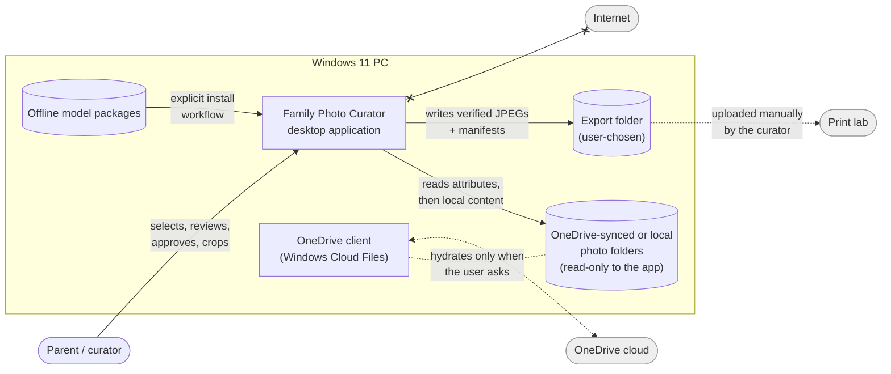
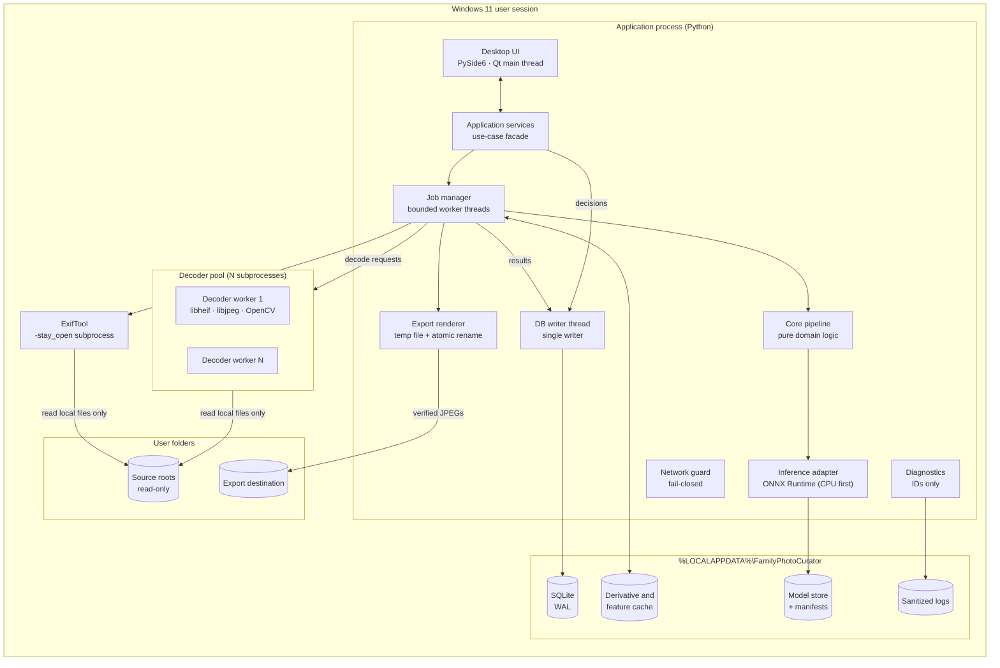
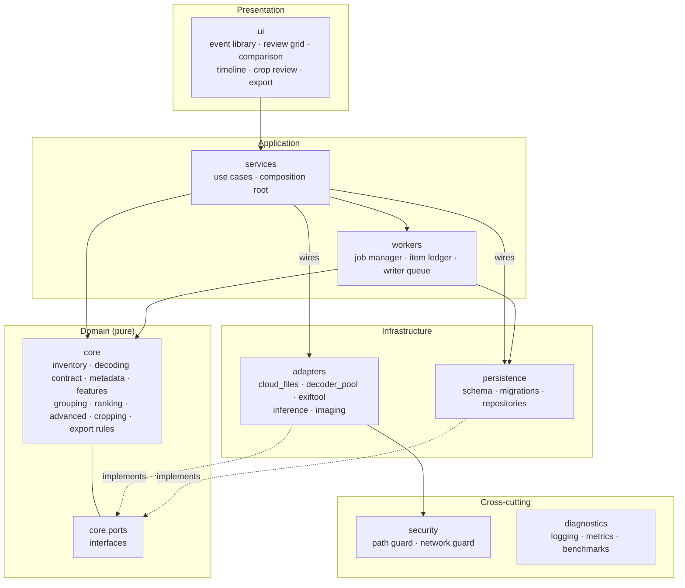
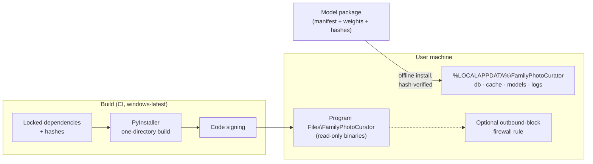
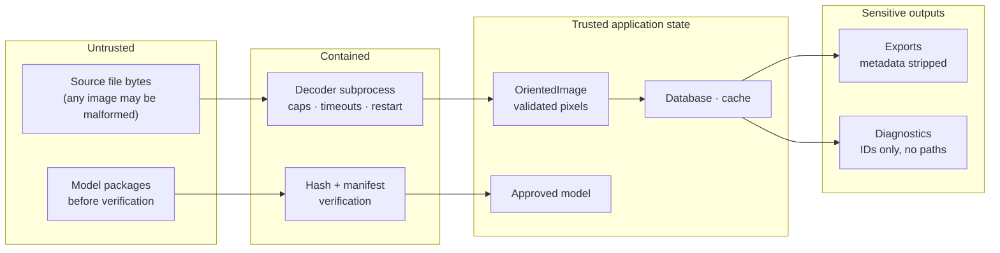

# 01 — Architecture Overview

| | |
|---|---|
| **Scope** | High-level architecture. Lower-level design is deferred (see [04 §8](04-technical-direction.md#8-deferred-to-low-level-design)). |
| **Source of requirements** | [Technical Specification v1.1](../spec/technical-specification-v1.1.md) |
| **Decisions** | [Architecture Decision Records](../adr/README.md) |

---

## 1. Architectural drivers

The architecture is shaped by a small number of non-negotiable qualities. When they conflict, the order below decides.

| Priority | Quality attribute | What it means here | Primary mechanisms |
|---|---|---|---|
| 1 | **Original integrity** | Source photos are never written, moved, renamed, or deleted | Read-only source access, path write guard, integrity tests |
| 2 | **Privacy** | No image or image-derived data leaves the machine | No network code, network guard, firewall rule, blocked-network tests |
| 3 | **Decision durability** | A human choice is never lost or silently overridden | Append-only decision log, single writer, WAL |
| 4 | **Safe ingestion** | Inventory never hydrates OneDrive files; hostile files never crash the app | Attribute-only first pass, isolated decoder processes |
| 5 | **Resumability** | Any job can stop at any point and continue without full recomputation | Per-item ledger, content-addressed cache |
| 6 | **Responsiveness** | The UI stays interactive while thousands of photos are processed | Background jobs, bounded pools, memory budget |
| 7 | **Evolvability** | Models, thresholds, and algorithms change without invalidating human work | Versioned cache keys, ports and adapters |
| 8 | **Cost** | Zero paid services; modest hardware | Local CPU-first inference, cheapest computation first |

---

## 2. System context

The application is a single-user desktop tool. Its only external relationships are the local filesystem and the person using it. The cloud and the print lab are outside the system boundary, by design.

**Key boundary decisions**

- The app never talks to OneDrive, Microsoft Graph, or any cloud API ([ADR-0001](../adr/0001-local-first-no-cloud-inference.md)). It works on files the OneDrive client has already made local ([ADR-0004](../adr/0004-two-pass-cloud-safe-inventory.md)).
- The app has no network path at all (`x--x`). Model installation is a separate, explicit, offline step.
- Printing is a manual hand-off of exported files.

---

## 3. Runtime view: processes and stores

The app runs as **one application process** plus a **pool of decoder subprocesses** and one **ExifTool subprocess** ([ADR-0003](../adr/0003-process-model-and-decoder-isolation.md)). All persistent state is local.

| Element | Responsibility | Why it is separate |
|---|---|---|
| Qt main thread | Rendering and input only | Never blocked by I/O or computation |
| Worker threads | Run pipeline stages on bounded batches | Keep the UI responsive; ONNX Runtime and OpenCV release the GIL |
| Decoder subprocesses | Turn untrusted bytes into pixels | A native crash or exploit is contained to one worker; the pool restarts it |
| ExifTool subprocess | Apple MakerNotes (`BurstUUID`, `ContentIdentifier`) | Mature parser; long-lived to avoid per-file process cost |
| DB writer thread | Serializes all writes | SQLite allows one writer; avoids lock contention and torn state |
| Cache | Analysis derivatives, thumbnails, embeddings | Large binary data stays out of SQLite; content-addressed for reuse |

The single-process choice is revisited if inference crashes or memory pressure show up in M0/M2 benchmarks ([ADR-0003](../adr/0003-process-model-and-decoder-isolation.md)).

---

## 4. Logical view: layers and components

The code is organized as **ports and adapters**. Core logic is pure and testable without Windows, Qt, native decoders, or models.

### 4.1 Component responsibilities

| Package | Owns | Does not own |
|---|---|---|
| `ui` | Views, view-models, keyboard handling, progress display | Any file, image, or database access |
| `services` | Use cases (`scan_event`, `analyze_event`, `record_decision`, `propose_crops`, `export_prints`), wiring adapters to ports | Algorithms |
| `workers` | Job lifecycle, `ProcessingItem` ledger, batching, cancellation, writer queue | Business rules |
| `core` | Domain model, pipeline stage logic, orientation rules, grouping, ranking, crop geometry, export rules, ports | I/O, threads, processes |
| `adapters` | Cloud-file attributes, decoder pool, ExifTool, ONNX sessions, color/encode | Business rules |
| `persistence` | SQLite schema, migrations, repositories, decision log | Business rules |
| `security` | Source write guard, network guard | — |
| `diagnostics` | Privacy-safe logging, metrics, benchmarks | — |

This refines the module list in spec v1.1 §4.4 by separating `services` (use cases) and `adapters` (OS and native integration) from `core`.

---

## 5. Dependency rules

These rules are **enforced by tests** in [`tests/architecture/`](../../tests/architecture/), not by convention.

| Layer | May import |
|---|---|
| `ui` | `services`, `core` (read-only types), `diagnostics` |
| `services` | `core`, `adapters`, `persistence`, `workers`, `security`, `diagnostics` |
| `workers` | `core`, `persistence`, `security`, `diagnostics` |
| `persistence` | `core`, `diagnostics` |
| `adapters` | `core`, `security`, `diagnostics` |
| `core` | `diagnostics` only |
| `security`, `diagnostics` | themselves only |

Additional enforced rules:

- No package outside `ui` imports a Qt toolkit. The engine runs headless.
- No module imports networking libraries, except `security/network_guard.py`, which uses `socket` only to block it.

---

## 6. Deployment view

- **One-directory build**, not one-file. This avoids antivirus false positives and the unpacking delay at startup.
- Binaries are read-only after install. All mutable state lives under `%LOCALAPPDATA%`, never under OneDrive, and that location is checked against detected sync roots.
- Model weights ship separately with manifests and hashes ([ADR-0007](../adr/0007-license-gated-model-registry.md)). This keeps the installer small and makes license review explicit.

---

## 7. Trust boundaries

| Boundary | Threat | Control |
|---|---|---|
| File bytes → pixels | Malformed or malicious images, decompression bombs | Subprocess isolation, pixel caps, timeouts, pinned decoders |
| Source roots | Accidental writes | Path guard rejects writes under any source root |
| Cloud placeholders | Unintended hydration | Attribute-only inventory pass; recall flags block opening |
| Model packages | Supply chain | Manifest, hash, and license gate |
| Process → network | Data exfiltration | No network imports, runtime guard, optional firewall rule |
| State → exports and diagnostics | Metadata leakage | GPS and device-ID stripping; logs use internal IDs |

---

## 8. Architectural invariants

These hold across every release. A design that breaks one needs a new ADR.

1. Nothing writes under a source root.
2. No component opens a file whose cloud-recall attributes are set.
3. All pixels come from the single decoding contract ([ADR-0006](../adr/0006-single-image-decoding-contract.md)).
4. Every human decision is an appended event. Derived state can be rebuilt from the log.
5. Every derived result is keyed by content and versions, never by path alone.
6. The application contains no network code path.
7. No face embeddings, face clustering, or identity data are created.
8. The UI receives encoded image bytes from `services`, never cache or source paths.
9. No UI action triggers hydration of a cloud file, including any "open in another app" action.
10. Error records, logs, diagnostics and benchmark output carry exception class and error code only: never message text, paths, usernames, machine names or file hashes.

Invariants 8–10 were added at [team meeting 1](../team/meetings/2026-11-07-kickoff.md) (decision D6).
