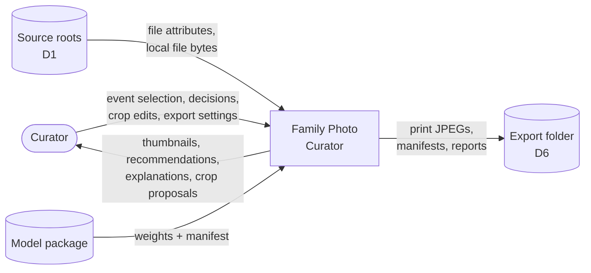
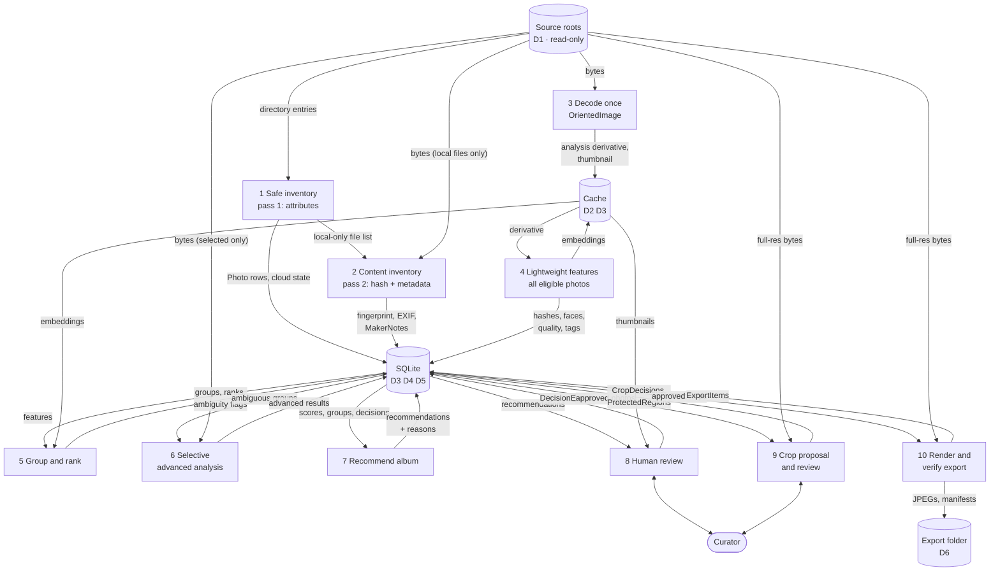
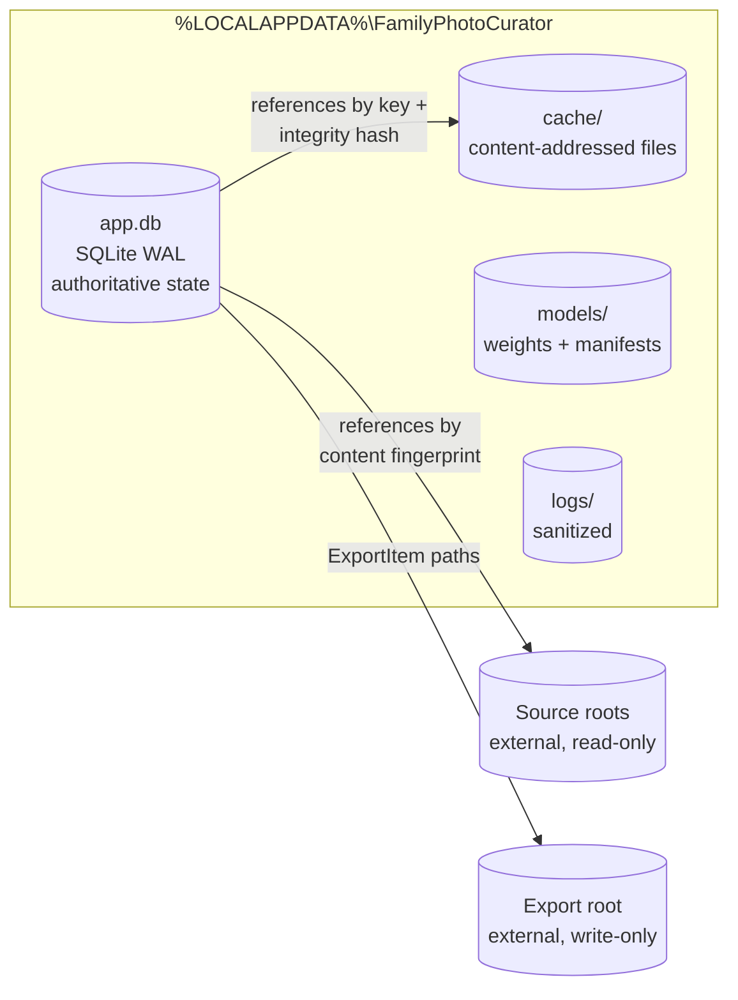
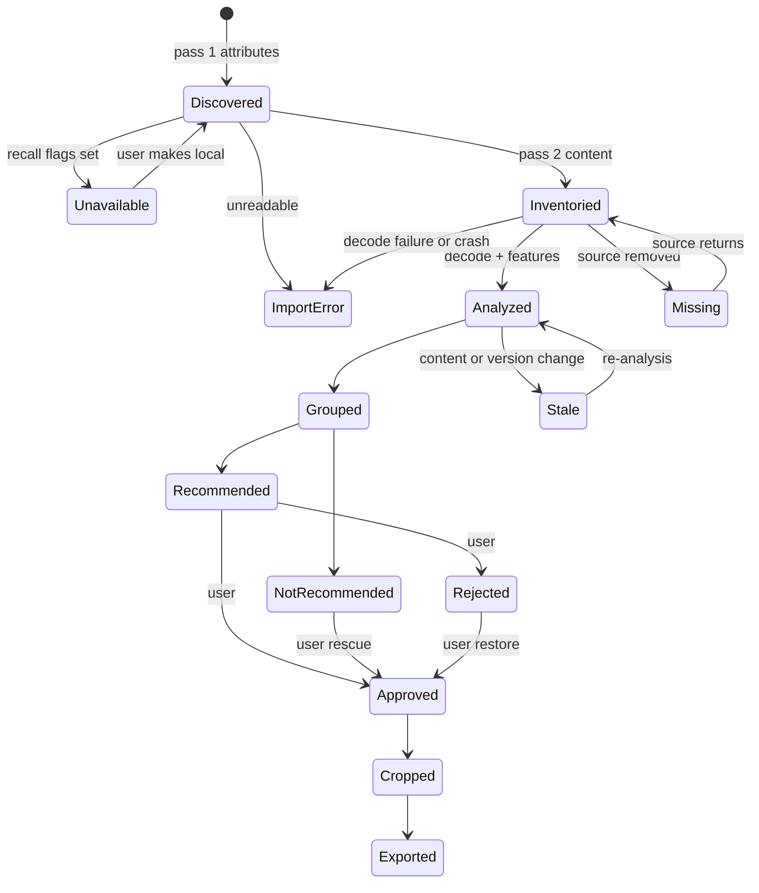

# 02 — Data Flow

How data enters, transforms, is stored, and leaves the system. It also covers where each class of sensitive data is allowed to exist.

---

## 1. Data classification

| Class | Examples | Sensitivity | May exist in | Never in |
|---|---|---|---|---|
| **D1 Originals** | HEIC/JPEG source files | Highest | Source roots only | Anywhere written by the app |
| **D2 Derived pixels** | Analysis derivatives, thumbnails, previews | High | Cache | Logs, diagnostics, network |
| **D3 Derived features** | Embeddings, face boxes, quality scores | High | Cache, DB | Logs, diagnostics, network |
| **D4 Personal metadata** | GPS, capture time, device IDs, folder names | High | DB (device IDs hashed) | Exports (by default), logs |
| **D5 Decisions** | Approvals, rejections, crops, protected regions | Medium (user's work) | DB | — |
| **D6 Outputs** | Print JPEGs, manifests | User-owned | Export folder | Source roots |
| **D7 Diagnostics** | Counts, timings, internal IDs, error codes | Low | Logs | Paths, pixels, features, D4 |

No face embeddings or identity data exist in any class ([spec v1.1 §16.3](../spec/technical-specification.md#163-privacy-by-design)).

---

## 2. Level 0 — context data flow



Only two flows leave the system: what the user sees on screen, and files written to the export folder they chose.

---

## 3. Level 1 — pipeline data flow



### 3.1 Flow notes

| Step | Input | Output | Key rule |
|---|---|---|---|
| 1 | Directory entries | `Photo` rows with cloud state | No file is opened. Recall-flagged files stop here as `unavailable`. |
| 2 | Local bytes | Fingerprint, metadata | Cloud state is re-checked immediately before each read. |
| 3 | Local bytes | `OrientedImage` → cached derivative | Runs in a decoder subprocess. Orientation is applied exactly once. |
| 4 | Derivative | Features | Runs for **every** eligible photo ([ADR-0005](../adr/0005-full-collection-lightweight-analysis.md)). |
| 5 | Features | Groups, ranks | Complete-linkage within time windows. No elimination. |
| 6 | Ambiguous or high-value groups | Advanced results | Selective. Full-resolution decode only when needed. |
| 7 | Scores, groups, decisions | Recommendations | Prior human decisions are inputs, never overwritten. |
| 8 | Recommendations | `DecisionEvent`s | Append-only. Written immediately. |
| 9 | Approved photos | Crop decisions | Pixel-aspect invariant enforced at the repository. |
| 10 | Approved crops | Verified files | Temp file, then atomic rename, then re-decode verification. |

---

## 4. Data stores



| Store | Authority | Content | Rebuildable? |
|---|---|---|---|
| Source roots | User / OneDrive | D1 | Not the app's to touch |
| `app.db` | **Authoritative** for app state | Events, photos, analyses, groups, decisions, crops, jobs, exports | Analyses: yes. **Decisions and crops: no.** They must be protected. |
| `cache/` | Derived | Derivatives, thumbnails, embeddings | Yes. It can be cleared at any time. |
| `models/` | Installed packages | Weights, manifests | Yes, by reinstalling |
| `logs/` | Diagnostic | D7 only | N/A |
| Export root | User | D6 | Yes, by re-exporting |

**Backup direction:** only `app.db` holds irreplaceable user work. The design should support a one-click backup of the database alone; the format is deferred to low-level design.

### 4.1 Cache key

Every derived artifact is addressed by:

```
content_fingerprint · analysis_type · algorithm_version · model_version ·
execution_provider · orientation_rule · configuration_hash
```

Changing any component produces a new key. Old entries stay valid for their own key and are garbage-collected under the storage budget.

---

## 5. Data lifecycle



- **Human states win.** `Approved` and `Rejected` come from the decision log and survive re-analysis, regrouping, and model upgrades.
- **Missing is not deleted.** If a source file disappears, its decisions are kept and the photo is marked `Missing`.
- **Stale is not discarded.** Re-analysis replaces derived data. It never touches decisions, and it flags manual crops for re-confirmation instead of recomputing them.

---

## 6. Data retention and removal

| User action | Removes | Keeps |
|---|---|---|
| Clear thumbnails / cache | `cache/` entries | Everything else |
| Delete embeddings | Embedding files and their references | Decisions, crops |
| Remove project | Event rows, cache entries, then `VACUUM` | Source files, exports |
| Delete exports | Export folder (user action in Explorer) | App state |

Source files are never removed by any action.
