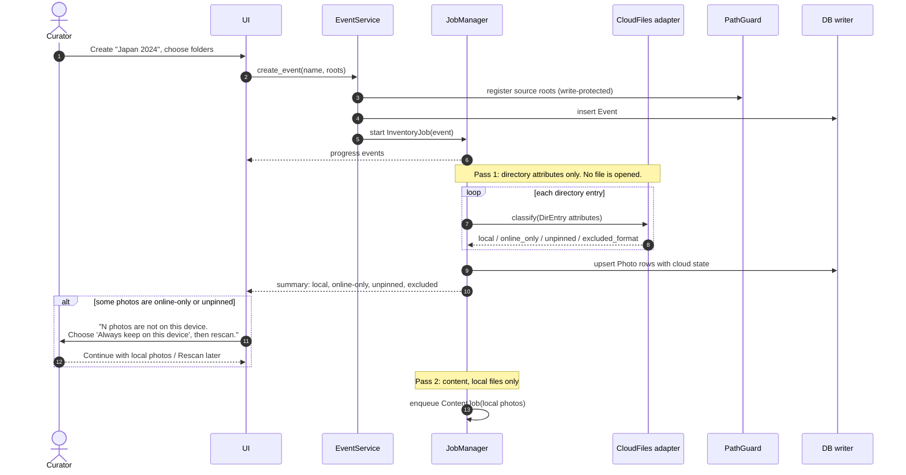
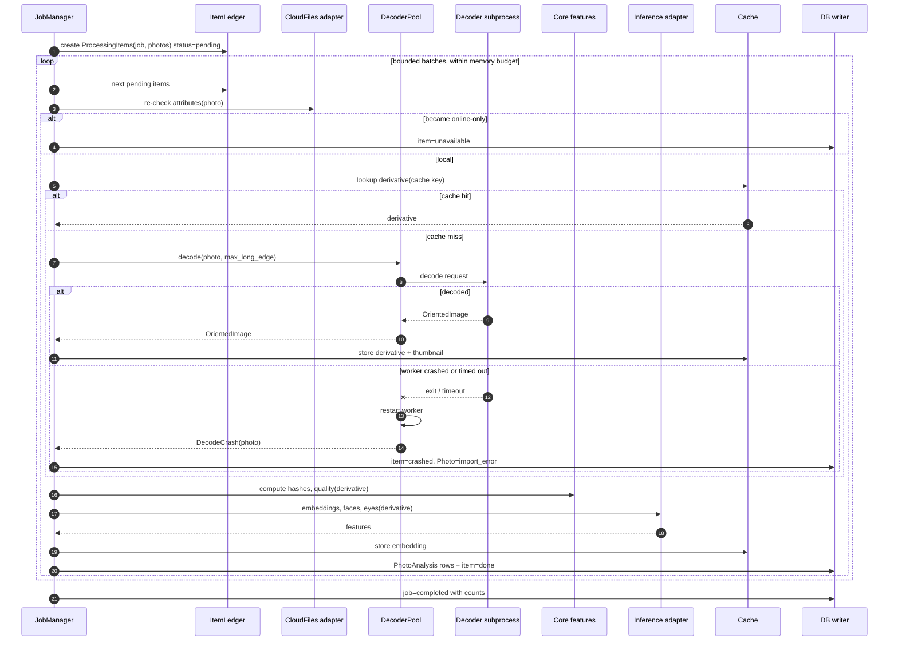
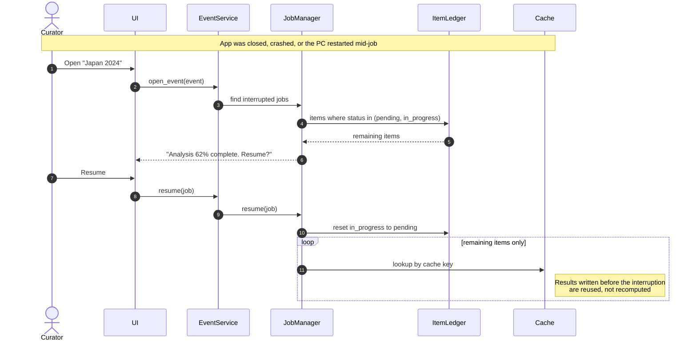
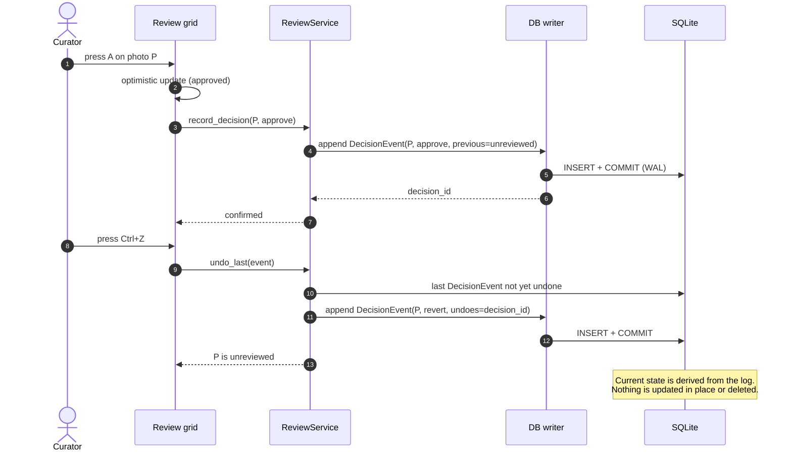
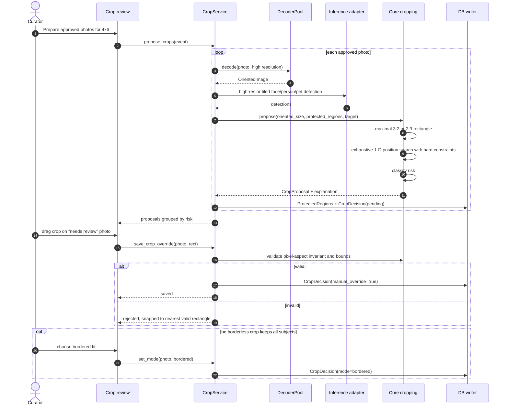
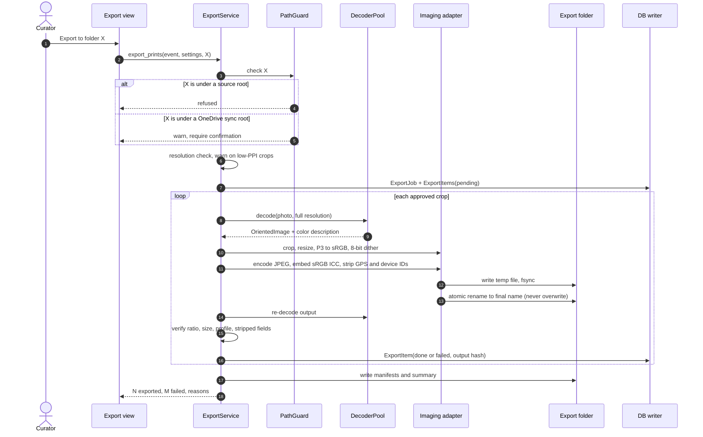
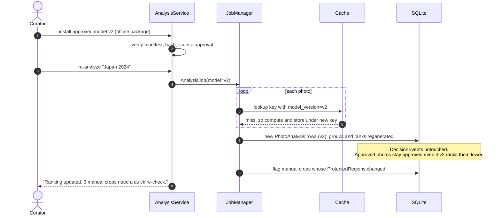

# 03 — Key Interaction Sequences

The core runtime interactions, at architectural level. Message names describe intent, not final function signatures.

| # | Sequence | Demonstrates |
|---|---|---|
| 1 | [Create event and safe inventory](#1-create-event-and-safe-inventory) | No hydration; partial import |
| 2 | [Analysis job with decoder isolation](#2-analysis-job-with-decoder-isolation) | Crash containment; per-item ledger; single writer |
| 3 | [Resume after interruption](#3-resume-after-interruption) | Resumability; cache reuse |
| 4 | [Review decision and undo](#4-review-decision-and-undo) | Append-only decisions; durability |
| 5 | [Crop proposal and manual override](#5-crop-proposal-and-manual-override) | Geometry invariant; protected regions |
| 6 | [Export and verification](#6-export-and-verification) | Atomic writes; verification; metadata stripping |
| 7 | [Re-analysis after a model upgrade](#7-re-analysis-after-a-model-upgrade) | Versioned cache; decisions preserved |

---

## 1. Create event and safe inventory

Pass 2 is itself a job. Its per-file steps follow sequence 2: it re-checks attributes, then hashes the file and reads metadata through the decoder pool and ExifTool.

---

## 2. Analysis job with decoder isolation

**Guarantees shown**

- A crash affects one photo, never the batch.
- Each item is marked `done` in the same write that stores its results, so a result can never exist without its ledger entry, and vice versa.
- All writes go through the single writer.

---

## 3. Resume after interruption

---

## 4. Review decision and undo

If a write fails, the UI rolls back its optimistic update and shows an error. A decision is shown as saved only after the commit succeeds.

---

## 5. Crop proposal and manual override

---

## 6. Export and verification

A retry skips items whose output already exists and matches the stored output hash.

---

## 7. Re-analysis after a model upgrade

