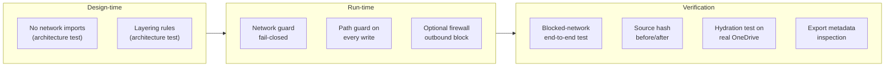
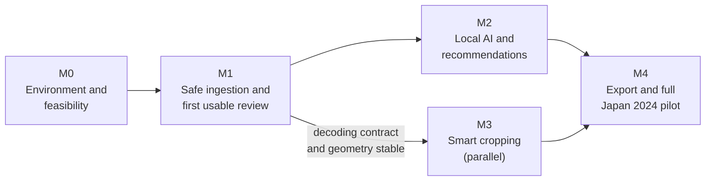

# 04 — High-Level Technical Direction

The direction engineering should follow, and the reasons behind it. Detailed designs (schemas, APIs, algorithms, thresholds) are deliberately deferred to low-level design documents written per milestone.

---

## 1. Architectural principles

| # | Principle | In practice |
|---|---|---|
| P1 | **Originals are sacred** | Read-only access. Every write path is checked against source roots. |
| P2 | **Local by construction** | Privacy is a tested property of the code, not a setting. |
| P3 | **Humans are authoritative** | Algorithms propose; recorded decisions stand. |
| P4 | **Cheapest reliable computation first** | Use attributes before bytes, cached derivatives before full decodes, light models before heavy ones. |
| P5 | **Analyze broadly, decide narrowly** | Every photo gets light analysis. Expensive work goes only where it changes an outcome. |
| P6 | **One way to see pixels** | A single decoding contract feeds every stage. |
| P7 | **Everything derived is versioned** | Results are keyed by content and versions, never by path or time alone. |
| P8 | **Fail per item, never per batch** | Errors are isolated, recorded, and retried. |
| P9 | **Evidence before commitment** | Models, thresholds, and accelerators are chosen from M0 and M2 benchmarks, not from assumptions. |
| P10 | **Useful early** | Each milestone ships something the curator can use. |

---

## 2. Decision summary

| ADR | Decision | Status |
|---|---|---|
| [0001](../adr/0001-local-first-no-cloud-inference.md) | Local-first; no cloud inference or cloud APIs | Accepted |
| [0002](../adr/0002-python-pyside6-onnx-stack.md) | Python 3.12, PySide6, ONNX Runtime, SQLite | Accepted |
| [0003](../adr/0003-process-model-and-decoder-isolation.md) | One application process plus an isolated decoder subprocess pool | Accepted, revisit after M2 |
| [0004](../adr/0004-two-pass-cloud-safe-inventory.md) | Two-pass inventory driven by cloud-file attributes | Accepted |
| [0005](../adr/0005-full-collection-lightweight-analysis.md) | Lightweight analysis of all eligible photos; selective advanced analysis | Accepted |
| [0006](../adr/0006-single-image-decoding-contract.md) | Single, format-aware image decoding contract | Accepted |
| [0007](../adr/0007-license-gated-model-registry.md) | Models loaded only from a hash- and license-verified registry | Accepted |
| [0008](../adr/0008-sqlite-authoritative-store-append-only-decisions.md) | SQLite as the authoritative store; append-only decision log; content-addressed file cache | Accepted |
| [0009](../adr/0009-owner-controlled-azure-vm.md) | Run on an owner-controlled Azure VM; agents never read photo data | Accepted |

---

## 3. Technology direction

| Concern | Direction | Rationale | Revisit when |
|---|---|---|---|
| Language | Python 3.12 | Best ecosystem for imaging and ML; fast iteration | Distribution or performance needs a native app (open decision 7) |
| UI | PySide6 Qt Widgets, no QtWebEngine | Native Windows desktop, LGPL, no embedded browser to audit | — |
| Inference | ONNX Runtime, CPU baseline | One runtime for all models; portable; deterministic per execution provider | — |
| Acceleration | Benchmark Windows ML, then DirectML | Windows ML is Microsoft's recommended path; DirectML is in maintenance mode | After the CPU baseline in M0/M2 |
| Decoding | Pillow + pillow-heif in subprocesses | Mature HEIC support; isolation contains native risk | Codec licensing review (distribution scope) |
| Metadata | Pillow/pillow-heif EXIF plus ExifTool `-stay_open` | Apple MakerNotes need ExifTool | — |
| Storage | SQLite (WAL) plus file cache | Embedded, transactional, zero administration | — |
| Packaging | PyInstaller one-directory, code-signed | Fewer AV false positives; faster startup | Native rewrite |
| Dependency control | Lock file with hashes (generated in M0) | Reproducibility; supply chain | — |
| CI | GitHub Actions on `windows-latest` | Target OS parity | — |

---

## 4. Quality attribute strategies

### 4.1 Integrity and privacy

Defense in depth: each layer assumes the one before it might fail.

### 4.2 Resumability and durability

- Per-item ledger (`ProcessingItem`). A job is just "the set of items not yet done."
- Results and their ledger status are committed in one transaction.
- Decisions are appended, never updated. Current state is a projection of the log.
- The cache is disposable, and the database is not. Backup direction covers the database only.

### 4.3 Performance

- **Decode once.** Each photo yields a ~1024 px analysis derivative that feeds every lightweight stage.
- **Bounded concurrency.** The decoder pool size and in-flight full-resolution decodes are limited by a memory budget.
- **Measure decode and inference separately.** Decoding is expected to dominate. This is unverified until M0.
- **No performance promises before benchmarks.** Timing figures in any document are hypotheses until measured on the target hardware.

### 4.4 Evolvability

- Ports isolate core logic from decoders, models, the OS, and storage.
- Versioned cache keys let models and thresholds change without manual cleanup.
- Human decisions are independent of algorithm versions.
- Ranking weights and the album objective are configuration with versions, not code constants.

### 4.5 Testability

| Level | Runs where | Covers |
|---|---|---|
| Architecture tests | Every CI run | Layering, headless engine, no network imports |
| Unit tests | Every CI run | Pure core logic, including property-based crop geometry |
| Integration tests | CI (Windows) | Decoder pool, SQLite, orientation fixtures, export pipeline |
| Privacy tests | CI and pilot | Blocked network, metadata stripping |
| OneDrive tests | Real synced machine (`-m onedrive`) | Hydration safety, dehydration mid-job |
| Performance | On demand (`-m slow`) | 5,000-photo benchmark, memory peak, resume |
| Evaluation | Milestone gates | Labelled Japan 2024 subsets, train/test split |

---

## 5. Cross-cutting conventions

| Concern | Direction |
|---|---|
| **Identity** | Photos are identified by content fingerprint. Paths are mutable locators. |
| **Versioning** | Every algorithm, model, orientation rule, and configuration carries an explicit version that becomes part of cache keys. |
| **Errors** | Typed, per-item results with error codes. No exceptions cross a job boundary unhandled. |
| **Configuration** | Versioned settings per event. The configuration hash is recorded with results. |
| **Logging** | Structured, internal IDs only. No paths, pixels, features, GPS, or folder names. |
| **Time** | Store the capture time with its original offset. The event day is the local capture date. Never invent a time zone. |
| **Units** | Crop rectangles are normalized to the **oriented** source and always stored with the oriented pixel size. |

---

## 6. Delivery roadmap

| Milestone | Architectural focus | Proves |
|---|---|---|
| M0 | Cloud-file detection, decoder isolation, model benchmarks, license review, labelled dataset | The architecture works on the real machine and real files |
| M1 | `core.inventory`, `core.decoding`, `adapters.cloud_files`, `adapters.decoder_pool`, `persistence`, `workers`, minimal `ui` | Safe ingestion and durable decisions end-to-end |
| M2 | `core.features`, `core.grouping`, `core.ranking`, `core.advanced`, `adapters.inference` | Broad, cheap analysis beats pHash/time-only ranking |
| M3 | `core.cropping`, crop UI | Face-safe cropping with less manual effort |
| M4 | `core.export`, `adapters.imaging`, privacy and integrity suites | Verified, color-managed prints from a full event |

---

## 7. Architectural risks

| Risk | Likelihood | Impact | Response |
|---|---|---|---|
| Cloud-file attributes behave differently across OneDrive versions | Medium | High | M0 prototype on the real machine; conservative default (unknown means unavailable) |
| Python and native-library packaging is fragile | Medium | Medium | One-directory build, CI packaging smoke test from M1 |
| Single app process hits GIL or memory limits | Low–Medium | Medium | Bounded pools; revisit ADR-0003 after the M2 benchmark |
| Candidate models fail license review | Medium | High | Multiple candidates per capability; license gate before integration |
| Decode throughput dominates on target hardware | Medium | Medium | Embedded HEIF thumbnails for previews; cache derivatives |
| Scope creep into identity features | Low | High | Invariant 7 in the [architecture overview](01-architecture-overview.md#8-architectural-invariants); needs an ADR to change |

---

## 8. Deferred to low-level design

These are intentionally **not** decided at this level. Each gets a low-level design document in the milestone that needs it.

| Topic | Milestone |
|---|---|
| SQLite schema DDL, indexes, migration tooling | M1 |
| Port interface signatures and result types | M1 |
| Decoder pool protocol (IPC format, shared memory vs pickling, timeouts) | M0/M1 |
| Cloud-file attribute handling details and fallback rules | M0/M1 |
| Thumbnail and derivative formats and sizes | M1 |
| UI navigation, view-models, keyboard map details | M1 |
| Embedding and face model choice, input preprocessing | M0/M2 |
| Grouping thresholds and linkage algorithm details | M2 |
| Ranking weights and album objective parameters | M2 |
| Crop scoring function and risk thresholds | M3 |
| Color rendering intent and JPEG encoder settings | M4 |
| Database backup format | M1 |
| Installer, signing, and firewall-rule mechanics | M4 |
