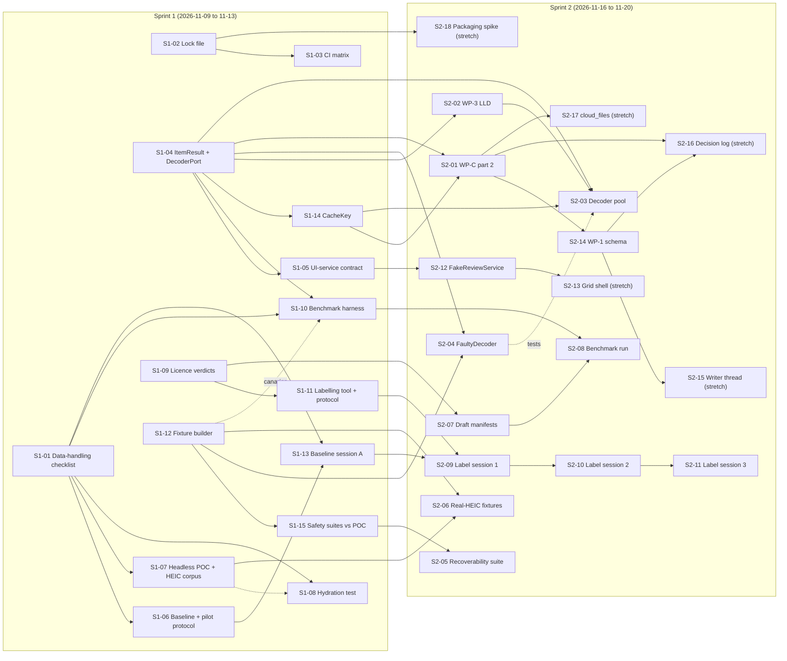

# Backlog draft: milestones and issues (for review)

| | |
|---|---|
| **Author** | Tech Lead |
| **Date** | 2026-11-07 (Saturday) |
| **Status** | Architect-reviewed (2026-11-07). PM questions Q6–Q10 open. **Nothing has been created on GitHub yet.** |
| **Sources** | [Kickoff minutes](../meetings/2026-11-07-kickoff.md) (D1–D14, sprint 1 backlog), [team charter](../README.md), [POC handoff](../../../poc/HANDOFF.md), [spec v1.1 §20](../../spec/technical-specification-v1.1.md#20-milestones), [`.github/labels.json`](../../../.github/labels.json) |

Local IDs (`S1-xx`, `S2-xx`, `EPIC-WP-x`) are placeholders. When the issues are created, each body gets its real `#number`, and references to other issues are rewritten to match.

---

## Architect review (2026-11-07)

Approved, with the corrections below already applied to this draft.

**Corrections made**

- **S1-06:** removed "randomised assignment of batch to tool". Batch A goes to Windows Photos and batch B to the M1 grid, which is a fixed assignment (PM round 2).
- **Issue-body headings** are level 4 in this document. They become `##` when pasted into GitHub, matching the work-item template.
- **EPIC-M1-GROUP** is renamed **EPIC-WP-8-M1** (see Q2).

**Answers to the Architect questions (§6)**

| Q | Decision |
|---|---|
| Q1 WP-C scope gap | **Agreed: S2-01 as drafted.** Use the D3 rule again. The signatures of `PhotoId`/`PhotoRecord`, `DecisionEvent` and `CloudFiles` freeze by **Wednesday 2026-11-18**, and WP-1 and WP-2 may start against that draft. The rest of S2-01 freezes at merge. Add the Wednesday freeze as an acceptance criterion on S2-01. |
| Q2 M1 grouping | **No new work package.** It is the M1 slice of WP-8: label it `wp:WP-8`, milestone M1. EPIC-WP-8 (M2) builds on it. |
| Q3 Content identity | **Split by responsibility.** The SHA-256 fingerprint is computed in WP-3, inside the decoder worker during ingest, so each file is read once (as in the POC). Identity rules and storage (moves, renames, changed content, spec §14.2) belong to WP-1. |
| Q4 QE implements WP-1 | **Confirmed.** The QE implements S2-14 and S2-16 as general implementer. Systems keeps the durability decisions: it approves the schema and the writer design, and it implements S2-15 itself. Systems reviews the QE's WP-1 PRs (D14). |
| Q5 Sprint tracking | **Approved: a GitHub Project with an iteration field.** No `sprint:N` labels. The product owner creates the Project, because agent tooling here cannot. Until then, the sprint line in each issue body is the source of truth. |

**Recommendations to the PM on Q6–Q10** (these are the PM's and owner's to decide)

- **Q6:** set the M2–M4 dates now, marked provisional in the milestone description. A visible date is easier to replan than a missing one.
- **Q7:** prefer days that are already fully local when matching batches A and B. If that's impossible, hydration caused by the owner's own copy is acceptable. Record it in the OneDrive run log, so it is never attributed to the app.
- **Q8:** the manual `pytest -m onedrive` run, logged in S1-08's run log, is enough for M0 and M1. A self-hosted runner is an owner convenience, not a requirement.
- **Q9:** accept. It matches the UX Engineer's round 2 proposal.
- **Q10:** agreed. This is the top owner ask for week 1.

---

## 0. Conventions used in this draft

**Sprint calendar.** Sprints are one week long (D14), Monday to Friday, and the Friday written status closes each one.

| Sprint | Dates | Notes |
|---|---|---|
| 1 | Mon 2026-11-09 to Fri 2026-11-13 | WP-0 sitting, WP-C, CI, fixtures |
| 2 | 2026-11-16 to 2026-11-20 | Labelling, benchmark run, WP-1/2/3 start |
| 3 | 2026-11-23 to 2026-11-27 | M0 close-out, WP-1/2/3 finish, WP-4 |
| 4 | 2026-11-30 to 2026-12-04 | WP-5; grid dry run on synthetic data |
| 5 | 2026-12-07 to 2026-12-11 | WP-6 on the real stack |
| 6 | 2026-12-14 to 2026-12-18 | **M1 pilot on batch B** (D1) |

**Every issue includes these two sections** (they are part of the definition of done and are not repeated below):

- *Not tested:* the PR states what was **not** run on the owner's PC or on real iPhone files. An issue isn't done without that line (meeting 1 outcome).
- *Gates:* `ruff check .` and `pytest` are green in CI, on Python 3.12, which is the reference (D8). AGENTS.md non-negotiables apply. The QE pre-reviews tests (time-boxed to one day). Systems reviews PRs written by the QE. The Architect gates PRs written by the Tech Lead (D14).

**Status labels.** An issue with no open dependency starts as `status:ready`. An issue that waits on another draft issue starts as `status:blocked` and moves to `status:ready` when the dependency merges. An issue that waits on an owner or Architect answer gets `status:needs-decision`.

**D1 check.** No sprint 1 or sprint 2 issue shows the owner POC rankings, scores, groups-as-recommendations or crops. The issues that touch the owner (S1-07, S1-08, S1-10, S1-13, S2-08 to S2-11) say so explicitly in their acceptance criteria.

---

## 1. Milestones

**Scheme: GitHub milestones are M0–M4 only. Sprints are tracked as an iteration field on a GitHub Project, not as milestones.** The reason: GitHub allows one milestone per issue, and the spec's exit criteria hang off M0–M4. Sprint milestones would force a choice between "which sprint" and "which exit criterion" on every issue. (See open question Q5 on the iteration field.) Each issue body also states its sprint in the Notes section, so nothing is lost if the Project isn't set up.

| Milestone | Title | Due | Description | Exit criteria (spec §20) |
|---|---|---|---|---|
| M0 | M0 — Environment and feasibility | **2026-11-27** (end of sprint 3) | Hardware inventory, OneDrive cloud-state prototype on the real PC, decoder isolation proof, format inventory, model and licence review, CPU benchmarks (decode and inference timed separately), labelled evaluation set, manual curation baseline. | Sample processes locally without hydration or crashes; model shortlist chosen on evidence; acceptance target values set. |
| M1 | M1 — Safe ingestion and first usable review | **2026-12-18** (pilot in sprint 6, D1) | Two-pass inventory, isolated decoding contract, metadata/time/devices/Live Photos, content identity, SQLite with migrations and decision log, exact and pHash/time grouping, minimal approve/reject grid with persistent decisions. | User can curate a 300–500 photo batch faster than with Windows Photos; zero source changes. |
| M2 | M2 — Local AI and recommendation engine | 2027-02-05 *(provisional, Q6)* | Embeddings and face/eyes detection, embedding-based grouping, within-group ranking, album recommendation, selective advanced analysis, caching, comparison UI, 5,000-photo benchmark. | Measurable improvement over pHash/time-only ranking on the test subset. |
| M3 | M3 — Smart cropping (parallel) | 2027-02-19 *(provisional, Q6)* | Crop geometry and invariant, high-res face protection, 1-D search, risk classes, manual editor, bordered output, crop evaluation. Starts once the decoding contract and geometry types are stable. | Crop review effort decreases with no unacceptable clipping on the labelled set. |
| M4 | M4 — Export and full Japan 2024 pilot | 2027-03-12 *(provisional, Q6)* | Colour-managed export, metadata stripping, verification, manifests, privacy and integrity suites, full-event run, performance and quality measurement, prioritised backlog. | Acceptance criteria met to the targets set in M0. |

M1's date is fixed by D1. M1 scope is not cut to hold it: if WP-C slips, the pilot slips (minutes §1). The M2–M4 dates are placeholders, to be replanned at the end of M0 when targets and the model shortlist are known.

---

## 2. Sprint 1 issues (fully specified)

There are 15 issues. The minutes' items #1–#13 keep their numbers as S1-01 to S1-13, so they trace back cleanly. Two items are split:

- **#4 is split** into S1-04 (`DecoderPort` + `ItemResult`, which must freeze mid-sprint under D3) and **S1-14** (`CacheKey`, which freezes at merge). One PR can't both freeze on Wednesday and stay open until Friday.
- **#12 is split** into S1-12 (fixture builder, manifest, canary tokens, malformed corpus) and **S1-15** (integrity, privacy and canary suites run against the POC). Together they were a heavy M with two separate review concerns: fixture licences, and the shape of the suite runner.

### S1-01 — WP-0 data-handling checklist ("what may leave the PC"), signed by owner

**Labels:** `role:security`, `wp:WP-0`, `type:docs`, `size:XS`, `status:ready`, `needs:owner`
**Milestone:** M0 · **Sprint:** 1 · **Depends on:** — · **Blocks:** S1-06, S1-07, S1-08, S1-10, S1-13, S2-08 to S2-11

#### Goal
The owner knows, and signs off in advance, exactly what each owner-PC activity produces and what may leave the machine.
#### Scope
- In: a one-page checklist covering the data directory location, what is allowed out (aggregates only) and what is forbidden, plus the clean-up steps after each sitting. It also records the owner's sign-off.
- Out: the threat model (WP-11); any tooling.
#### Acceptance criteria
- [ ] The checklist is committed at `docs/security/wp0-data-handling-checklist.md`.
- [ ] It requires the data directory to be under `%LOCALAPPDATA%`, outside every OneDrive root. It is deleted or archived after each sitting (minutes, Security round 1).
- [ ] It requires the POC to run headless, with no `--out` and no `--auto-approve`.
- [ ] It lists what is **allowed out**: counts, rates with sample size and CI, timings, and error-class histograms (D2).
- [ ] It lists what is **forbidden**: paths, folder names, thumbnails, crops, GPS, timestamps, content hashes, machine name, username, label files, and message text (D2, D6 invariant 10).
- [ ] It states that agents never receive personal photos, caches or label files.
- [ ] It has a per-sitting sign-off line: date, activities covered, and the owner's initials. The owner's signature is recorded on this issue before S1-07 starts.
#### Notes
- Links: D2, D6; spec §16; design 01 §8 invariant 10.
- Size: XS, because it is short prose. Biggest risk: the owner's availability to sign in week 1.

---

### S1-02 — Hashed lock file; CI installs pinned versions only

**Labels:** `role:systems`, `wp:WP-0`, `type:chore`, `size:S`, `status:ready`, `needs:security`
**Milestone:** M0 · **Sprint:** 1 · **Depends on:** — · **Blocks:** S1-03, S2-18

#### Goal
Every CI and developer install resolves to the exact, hash-verified versions in a committed lock file.
#### Scope
- In: a lock file for the runtime, `ui` and `dev` extras on Windows and Linux, Python 3.12. Also the CI install step, and a short "how to update the lock" note.
- Out: PyInstaller packaging (S2-18, WP-12); model weights (ADR-0007, S2-07).
#### Acceptance criteria
- [ ] The lock file is committed with a hash for every package (`pip install --require-hashes` succeeds from it).
- [ ] `.github/workflows/ci.yml` installs only from the lock file. Any unpinned `pip install` in CI fails the job, including the POC job (`poc/requirements.txt` gets pinned or locked as well).
- [ ] The editable install of the project uses `--no-deps`, so no transitive dependency is resolved outside the lock.
- [ ] The update procedure is documented in one paragraph, in `README.md` or `docs/`.
- [ ] Security has reviewed the dependency list. The licence of each runtime dependency is recorded, including what the `pillow-heif` wheel actually bundles (libheif, libde265, and whether x265 is present); this links to S1-09.
#### Notes
- Links: HANDOFF WP-0 ("lock file"); Security ask in round 1; D8.
- Size: S. Biggest risk: platform-specific wheels (opencv, onnxruntime, PySide6) need per-platform hashes.

---

### S1-03 — CI: Python 3.12 on Windows + Linux, markers, pip cache, nightly `slow`, manual `onedrive` job

**Labels:** `role:quality`, `wp:WP-12`, `type:chore`, `size:S`, `status:blocked`
**Milestone:** M1 · **Sprint:** 1 · **Depends on:** S1-02

#### Goal
CI is the reference environment (D8). It runs on both platforms, enforces the test markers, and has scheduled and manual jobs for slow and OneDrive tests.
#### Scope
- In: a matrix (`windows-latest`, `ubuntu-latest`) on Python 3.12, pip caching keyed on the lock file, a nightly `-m slow` workflow, and a `workflow_dispatch` job for `-m onedrive` that runs on a self-hosted runner or by hand on the owner's PC. Coverage reporting, with no threshold yet.
- Out: packaging smoke tests (WP-12); a self-hosted runner on the owner's PC (see Q8 for whether it is allowed).
#### Acceptance criteria
- [ ] The CI `test` job runs on both OSes and is green; the `poc` job runs at least on Windows.
- [ ] `--strict-markers` is kept. A test that uses an unregistered marker fails CI (shown by a throwaway commit described in the PR).
- [ ] The default job excludes `onedrive` and `slow`. The nightly job runs `slow`. The manual job runs `onedrive` and fails loudly, not as a skip, when no OneDrive root is configured.
- [ ] A cache hit is visible in the logs of a second run.
- [ ] The job names `CI / test` and `CI / poc` are unchanged, so branch protection still matches (charter §3).
#### Notes
- Links: D8; QE round 1; charter §3 (required checks).
- Size: S. Biggest risk: Linux has no cloud-files APIs, so `windows_only` tests must skip cleanly on Linux.

---

### S1-04 — WP-C: `ItemResult` and `DecoderPort.decode(request, deadline)`, frozen mid-sprint

**Labels:** `role:architect`, `role:systems`, `wp:WP-C`, `type:feature`, `size:S`, `status:ready`, `needs:architect`
**Milestone:** M1 · **Sprint:** 1 (freeze target: **Wed 2026-11-11**) · **Depends on:** — · **Blocks:** S1-05, S1-10, S1-14, S2-01 to S2-05

#### Goal
Workers, the decoder pool and the QE's fault tests share one frozen result type and one decoder port, so WP-3 and QE work can start in parallel (D3).
#### Scope
- In: an `ItemResult` frozen dataclass in `core/` with a status enum `ok | unavailable | error | crashed | timeout | quarantined`, an exception class name, an error code, decode and compute timings, and a typed payload (no free-form dicts, no message text). A `DecoderPort` protocol in `core/ports/` with `decode(request, deadline)`, where `deadline` is **required**. A `DecodeRequest` type. Docstrings. Architecture tests updated.
- Out: the implementation (S2-03); `CacheKey` (S1-14); the other HANDOFF §3 contracts (S2-01).
#### Acceptance criteria
- [ ] Calling `DecoderPort.decode` without a deadline is a type error, checked by a test with a typed stub implementation.
- [ ] `ItemResult` has no field that can hold free text. A unit test asserts that constructing it with a message string fails (D6 invariant 10).
- [ ] `ItemResult` round-trips through its serialised form, as used across the process boundary.
- [ ] `tests/architecture/test_layering.py` passes, and the new modules import no Qt, no adapters and no network modules.
- [ ] By Wednesday 2026-11-11 the Architect records on this issue that the signature and enum are frozen (D3). Any later change goes in its own PR.
#### Notes
- Links: D3, D4, D5, D6; HANDOFF §3; design 04 §5; ADR-0003, ADR-0006.
- Systems drafts and the Architect approves. Size: S, because it is a small surface; most of the cost is review.
- Biggest risk: freezing slips past mid-sprint, which delays S2-03 and S2-04.

---

### S1-05 — WP-C: UI–service contract draft (bytes only, callbacks, progress events)

**Labels:** `role:ux`, `role:tech-lead`, `wp:WP-C`, `type:feature`, `size:S`, `status:blocked`, `needs:architect`
**Milestone:** M1 · **Sprint:** 1 · **Depends on:** S1-04 · **Blocks:** S2-12, EPIC-WP-5, EPIC-WP-6

#### Goal
The review UI and `services` agree on one interface, so the grid can be built against a fake before the backend exists.
#### Scope
- In: protocol definitions and docstrings for the following:
  - `list_photos(event, view)` (paged)
  - `request_thumbnail(id, size, priority)` and `cancel_thumbnail(id)`, returning encoded bytes **or** a reason (`cloud_only`, `decode_failed`, `timeout`)
  - `record_decision`, returning `confirmed` or `failed`
  - `undo_last`
  - `review_summary`
  - `JobProgress(done, total, failed)`, plus `finished`, `cancelled` and `cancel_job`
  - plain callbacks, with no Qt types in the contract.
- Out: the `FakeReviewService` implementation (S2-12); the real services (WP-5); thumbnail scheduling internals (D4).
#### Acceptance criteria
- [ ] No method returns or accepts a filesystem path. A test introspects the protocol's type hints and fails on `str` or `Path` fields named `*path*` (D6 invariant 8).
- [ ] No method can start hydration. The docstring of each method that reads pixels states that cloud-only items return the reason `cloud_only` (D6 invariant 9).
- [ ] The contract module imports nothing from Qt (layering test).
- [ ] The PM has confirmed on the issue that the contract covers WP-6's M1 scope: grid, A/X/U, undo, import-problems view, and save state.
- [ ] Architect approval is recorded, because this is a `services` interface (charter §2).
#### Notes
- Links: D3, D6; UX round 1; spec §11; charter §2 ("UI–service contract").
- The Tech Lead co-authors this, so the Architect gates it (D14). Size: S.
- Biggest risk: paging and priority semantics may need a rework once WP-5 exists. Accepted, because it is a draft and freezes at merge.

---

### S1-06 — Manual baseline protocol + WP-6 user-test protocol; batch A and B selection

**Labels:** `role:pm`, `role:ux`, `wp:WP-0`, `type:docs`, `size:S`, `status:blocked`, `needs:owner`
**Milestone:** M0 · **Sprint:** 1 · **Depends on:** S1-01 · **Blocks:** S1-13, S2-09

#### Goal
"Faster than Windows Photos" is measured the same way in the baseline (batch A) and in the M1 pilot (batch B).
#### Scope
- In: one protocol document used for both sessions, covering:
  - the task ("choose the photos you'd print")
  - what counts as a decision (the final state per photo; undo doesn't add one)
  - when the clock starts and stops, with thumbnails warmed in both tools
  - a 5-minute warm-up on a throwaway batch
  - the metrics recorded: approved count, later changes, and 1–5 effort
  - Windows Photos running on a local copy
  - fixed assignment: batch A to Windows Photos (baseline, weeks 1–2), batch B to the M1 grid (pilot, week 6). Randomisation isn't possible because the grid doesn't exist yet (PM round 2); matching the batches carries the fairness
  - the selection rule for two matched batches of about 400 photos each, from different days.
- Out: running the sessions (S1-13, EPIC-WP-6); the labelling protocol (S1-11).
#### Acceptance criteria
- [ ] The protocol is committed at `docs/evaluation/review-speed-protocol.md`, and both the PM and the UX Engineer have approved it.
- [ ] The batch selection rule uses only aggregates computed on the owner's PC (per-day photo counts, burst counts, HEIC share). No photo, path or date leaves the machine (D2). The chosen days are recorded **only** on the owner's PC.
- [ ] The protocol states that batches A and B are excluded from all labelling sessions (D1), and S1-11's tool takes the exclusion list as input.
- [ ] The protocol states that the M1 grid shows no rankings during the pilot.
- [ ] It defines the result record (time, decisions, approved count, changes, effort) and states that only that record leaves the PC.
#### Notes
- Links: D1, D2; spec §18.4 item 3, §19 "Workload reduction"; UX and PM round 1.
- Open: whether making a local copy of batch A means the owner hydrates those files themselves (Q7).
- Size: S. Biggest risk: we can't match the batches without seeing them. That is why matching uses aggregates only.

---

### S1-07 — Owner-PC sitting: headless POC run + private HEIC sample corpus

**Labels:** `role:systems`, `wp:WP-0`, `type:spike`, `size:M`, `status:blocked`, `needs:owner`, `needs:security`
**Milestone:** M0 · **Sprint:** 1 · **Depends on:** S1-01 · **Blocks:** S1-08 (same sitting), S2-06

#### Goal
We learn whether the POC processes Japan 2024 on the real machine without hydration or crashes, and what the real HEIC files look like, without anything personal leaving the PC.
#### Scope
- In: recording the hardware profile (§22.1); a headless POC run over Japan 2024 under the S1-01 checklist; a format inventory (HEIC vs JPEG share, presence of Apple MakerNotes, `irot`/`imir` and `nclx` frequencies); a private HEIC sample corpus kept **on the owner's PC only**; an aggregate results report.
- Out: showing the owner any output (D1); the hydration instrumentation (S1-08); benchmarks (S1-10, S2-08).
#### Acceptance criteria
- [ ] The run follows the S1-01 checklist: headless, data directory under `%LOCALAPPDATA%`, no `--out`, no `--auto-approve`. The completed checklist is recorded on the issue.
- [ ] **Nothing is shown to the owner.** No UI is launched, and no ranking, score, group or crop is displayed or exported (D1).
- [ ] The report that leaves the PC has aggregates only: file counts by format and cloud state, error-class histogram, crash and hang counts, total and per-stage times, and the hardware profile (no machine name). It is committed at `docs/evaluation/m0/owner-pc-sitting-1.md`, after Security reviews it for D2 compliance.
- [ ] Online-only files are counted and skipped, never opened (ADR-0004).
- [ ] The HEIC corpus stays on the owner's PC; its location is recorded only there. The issue states only the corpus's size and feature counts.
- [ ] The data directory is deleted or archived per the checklist, and the owner confirms this on the issue.
#### Notes
- Links: D1, D2; spec §20 M0, §22.1–22.2; ADR-0004; POC `poc/fpc_poc/pipeline.py`.
- Same sitting as S1-08 and the S1-10 dry run (D1); Security attends.
- Size: M, because the POC on Windows with real data is untested. Biggest risk: a hang wedges the run (the POC pool can't kill hung workers). Mitigation: run per folder with a wall-clock limit.

---

### S1-08 — Owner-PC sitting: OneDrive hydration test with run log

**Labels:** `role:quality`, `wp:WP-0`, `type:test`, `size:S`, `status:blocked`, `needs:owner`, `needs:security`
**Milestone:** M0 · **Sprint:** 1 · **Depends on:** S1-01, S1-07 (same sitting)

#### Goal
We have instrumented evidence, on the real OneDrive machine, that inventory reads no online-only file.
#### Scope
- In: an instrumented hydration test per spec §18.3, which snapshots the recall and offline attributes plus OneDrive's downloaded-bytes indicator before and after an inventory pass over a folder containing online-only placeholders. Also the OneDrive run-log format, and the first entry in it.
- Out: the production inventory (WP-2); a CI-hosted version, since hosted CI can't prove non-hydration.
#### Acceptance criteria
- [ ] The test is committed as `tests/.../test_hydration_*.py`, marked `onedrive` and `windows_only`. It fails if any placeholder's attributes change, or if downloaded bytes increase.
- [ ] The test folder contains at least one online-only placeholder; the test asserts this precondition and does not pass vacuously.
- [ ] The run log is committed at `docs/evaluation/onedrive-run-log.md`, with date, OneDrive client version, Windows build, result, and placeholder count. It contains no paths (D2, D6).
- [ ] The issue states that only instrumented runs count as §18.3 evidence (D13), and that this run covers the POC inventory, not production.
#### Notes
- Links: D13; spec §18.3, §19 "OneDrive safety"; ADR-0004; POC `poc/fpc_poc/inventory.py`.
- Systems and Security attend. Size: S. Biggest risk: the downloaded-bytes indicator isn't observable. In that case, fall back to attributes plus file-size-on-disk, and record the limitation.

---

### S1-09 — Licence and training-data verdicts for candidate models and pillow-heif codecs

**Labels:** `role:security`, `wp:WP-0`, `type:spike`, `size:S`, `status:ready`
**Milestone:** M0 · **Sprint:** 1 · **Depends on:** — (assumes family-only until §22.7 is answered) · **Blocks:** S1-11, S2-07, S2-08

#### Goal
The Data Scientist knows which candidate weights may be downloaded and benchmarked, and the team knows what the HEIC decoder obliges us to do.
#### Scope
- In: written verdicts (green, amber or red, with reasons) for YuNet, BlazeFace, SCRFD, MediaPipe Face Mesh, YOLOX, NanoDet, RT-DETR, SigLIP, DINOv2 and OpenCLIP. Each verdict covers code licence, weights licence and training-data terms. Also pillow-heif's bundled libheif/libde265/x265 and the HEVC patent position for family-only use.
- Out: wider-distribution legal advice (only needed if §22.7 says "wider"); ADR-0007 manifests (S2-07).
#### Acceptance criteria
- [ ] A verdict table is committed at `docs/security/model-licence-verdicts.md`, with a source link for each licence claim.
- [ ] SCRFD is recorded as benchmark-only/amber unless the D10 conditions are met.
- [ ] The table states the §22.7 assumption (family-only) and which verdicts change if the answer is "wider".
- [ ] Nothing in this table is a download. The DS downloads only after the verdict is recorded (Security round 1).
#### Notes
- Links: D10; ADR-0007; spec §22.7; DS and Security round 1.
- Size: S. Biggest risk: training-data provenance is unclear for some weights. Default to amber.

---

### S1-10 — Offline benchmark harness with scrubber test (run happens in sprint 2)

**Labels:** `role:systems`, `wp:WP-0`, `type:feature`, `size:S`, `status:blocked`, `needs:owner`, `needs:security`
**Milestone:** M0 · **Sprint:** 1 · **Depends on:** S1-01, S1-04 · **Blocks:** S2-08

#### Goal
There is a single harness that times decode and inference separately on the owner's PC (D9) and can only emit privacy-safe output.
#### Scope
- In: a headless script in `tools/benchmark/`. It records hardware and versions, per-stage timings (decode separate from inference), peak working set per worker, cold vs warm cache, and the count of online-only files skipped. It writes one local JSON file. An automated scrubber test runs in CI. There is a dry run on the owner's PC with the POC decoders only, and no models.
- Out: running the candidate models (S2-08); the evaluation metrics (S1-11, EPIC-WP-13).
#### Acceptance criteria
- [ ] The output JSON schema has no field for paths, file names, file hashes, timestamps, machine name or username. A CI scrubber test runs the harness on the synthetic event, scans the output for those patterns (including the synthetic GPS and the canary tokens from S1-12), and fails on any hit (D6 invariant 10).
- [ ] Records use `ItemResult` (S1-04) for per-item status, with error class and code only.
- [ ] Online-only files are skipped and counted, never opened (ADR-0004).
- [ ] Model weights load only through a hash check against a manifest. The harness refuses to run a model with no manifest entry (ADR-0007).
- [ ] The dry run on the owner's PC completes under the S1-01 checklist, and the owner reviews the JSON before anything is shared (Systems round 1).
#### Notes
- Links: D2, D6, D9; spec §20 M0 ("decode and inference timed separately"); Systems round 1.
- Size: S. Biggest risk: measuring peak working set per spawned worker on Windows. Use `psutil` only if it is in the lock file (S1-02).

---

### S1-11 — Minimal labelling tool in `tools/labeling/`; pre-registered evaluation protocol

**Labels:** `role:data-scientist`, `wp:WP-13`, `type:feature`, `size:S`, `status:blocked`, `needs:security`
**Milestone:** M0 · **Sprint:** 1 · **Depends on:** S1-09 (the protocol cites the metrics per model class) · **Blocks:** S2-09 to S2-11

#### Goal
The owner can label critical moments, same/different pairs, and best-of-group on their own PC, with the metrics fixed before any labelling.
#### Scope
- In: a deliberately plain offline tool in `tools/labeling/`, which is not in `src/` (D12). It uses a different keymap from the review grid, runs under the network guard, reads pixels through the decoding path (ADR-0006), takes an exclusion list for batches A and B, and writes labels to a local file only. A pre-registered protocol: metrics, train/test split rule, 10% repeat set for self-consistency, bootstrap by group, and N for Precision@N left as a placeholder until §22.5.
- Out: AI-assisted labelling; showing model or POC output in the tool; crop labels (M3).
#### Acceptance criteria
- [ ] The tool displays **no** POC or model score, rank, group-as-recommendation or crop. A test asserts that the tool imports nothing from `poc/fpc_poc/ranking.py` or `crop.py` (D1, spec §18.4 item 1).
- [ ] Its keymap shares no decision keys with the WP-6 grid (A/X/U) (D12).
- [ ] Photos whose days are in the exclusion list never appear in any session; a test on the synthetic event covers this (D1).
- [ ] The network guard is active, and a test shows that an outbound socket attempt fails.
- [ ] The label file is written under the data directory. The tool has no export or upload function. The only thing it outputs to share is an aggregate summary (counts per label type).
- [ ] The protocol is committed at `docs/evaluation/evaluation-protocol.md` before session 1, and the commit is dated before S2-09 starts.
- [ ] The critical-moment definition is taken verbatim from the owner's §22.10 answer. If there is no answer yet, the issue stays `status:needs-decision` for that criterion only.
#### Notes
- Links: D1, D11, D12; spec §18.4, §22.10; DS round 1.
- POC reference: the thumbnail loading in `poc/fpc_poc/ui.py` may be reused (D12).
- Size: S, because it is plain on purpose. Biggest risk: the §22.10 answer arrives late.

---

### S1-12 — Seeded fixture builder + manifest + canary tokens + generated malformed corpus

**Labels:** `role:quality`, `role:data-scientist`, `wp:WP-11`, `type:test`, `size:M`, `status:ready`, `needs:security`
**Milestone:** M1 · **Sprint:** 1 · **Depends on:** — · **Blocks:** S1-10 (scrubber canaries), S1-15, S2-04, S2-05, S2-06

#### Goal
Every test builds its photo fixtures from one seeded, licence-clean builder with known expected outcomes.
#### Scope
- In: porting `poc/tools/make_sample_event.py` into `tests/fixtures/` as a seeded builder. A manifest of expected outcomes per file (orientation, cloud state, expected status, expected group). JPEG orientations 1–8. Canary tokens embedded in metadata and file names, so leaks can be detected. A generated malformed-bytes corpus. GPS clearly labelled as synthetic. Adversarial stand-ins from the DS (face-like near-misses) where they are generated, not downloaded.
- Out: HEICs with real `irot`/`imir`/`nclx` (S2-06); hang cases (S2-04); the 5,000-photo scale mode (EPIC-WP-13 / M2).
- **No test seams:** the POC's environment-variable crash marker is **not** carried over (D5).
#### Acceptance criteria
- [ ] The same seed produces byte-identical output twice (test).
- [ ] Every generated file has a manifest entry, and every manifest entry has a file (test).
- [ ] A CI check fails if any committed image under `tests/` is missing from the manifest or has no licence entry (QE round 1).
- [ ] JPEG orientations 1–8 decode to the manifest's expected pixel orientation through the POC decoder.
- [ ] The malformed corpus has at least one truncated, one corrupt-header and one oversized-dimension file. None of them is a real exploit sample.
- [ ] Synthetic GPS is tagged as synthetic in the manifest.
- [ ] `git grep` finds no environment-variable crash trigger under `src/` or `tests/fixtures/` (D5).
#### Notes
- Links: D5; HANDOFF §1; spec §18.1–18.2; QE round 1; AGENTS.md (synthetic fixtures only).
- Size: M. Biggest risk: scope creep into S2-06. Real HEIC metadata is explicitly out.

---

### S1-13 — Windows Photos baseline session on batch A

**Labels:** `role:pm`, `wp:WP-0`, `type:test`, `size:XS`, `status:blocked`, `needs:owner`
**Milestone:** M0 · **Sprint:** 1 (may slip into week 2 per D1) · **Depends on:** S1-01, S1-06 · **Blocks:** S2-09

#### Goal
We record how long the owner takes to curate batch A in Windows Photos, before they see any AI output or label anything.
#### Scope
- In: one session following S1-06 exactly, on a local copy of batch A, recorded in the protocol's result record.
- Out: anything involving the POC or our UI.
#### Acceptance criteria
- [ ] The session follows S1-06, including the warm-up, warmed thumbnails, and the clock start and stop rules. Any deviation is written on the issue.
- [ ] It happens **before** any labelling session and before the owner sees any POC output (D1, spec §18.4 item 1).
- [ ] Only the result record leaves the PC (time, decisions, approved count, later changes, effort 1–5). It is committed at `docs/evaluation/m0/baseline-batch-a.md`.
- [ ] The local copy of batch A sits outside every OneDrive root and source root, and no source file is modified. The owner confirms this.
#### Notes
- Links: D1; spec §18.4 item 3, §19 "Workload reduction"; UX round 1.
- Size: XS for our side, about 1 hour of owner time. Biggest risk: the owner is unavailable in week 1. It slips to week 2, which pushes S2-09.

---

### S1-14 — WP-C: `CacheKey` value object with canonical serialisation (split from #4)

**Labels:** `role:architect`, `role:systems`, `wp:WP-C`, `type:feature`, `size:S`, `status:blocked`, `needs:architect`
**Milestone:** M1 · **Sprint:** 1 · **Depends on:** S1-04 · **Blocks:** S2-01, S2-03, EPIC-WP-7

#### Goal
Every derived result is keyed by content and every version that affects it, never by path or hash alone (design 01 §8 invariant 5).
#### Scope
- In: a frozen `CacheKey` in `core/` with every component in design 02 §4.1: content, analysis, algorithm, model, execution provider, orientation rule, and config hash. It has canonical serialisation and a stable digest, plus docstrings.
- Out: the cache implementation and eviction (EPIC-WP-5 / M2); §22.9 budget.
#### Acceptance criteria
- [ ] Changing any single component changes the digest; this is a property-based test over all components.
- [ ] Serialisation is canonical: field order and float formatting can't change the digest (test).
- [ ] The type can't be built from a path (no path-typed field), and it carries no machine-specific value (test).
- [ ] The layering test passes. The contract freezes at merge (D3).
#### Notes
- Links: D3; design 02 §4.1; design 01 §8 invariant 5; Systems round 1 (the POC cache was keyed on SHA-256 only).
- Size: S. Biggest risk: the definition of "config hash" (which config is included) needs the Architect's call.

---

### S1-15 — Integrity, privacy and canary suites run against the POC (split from #12)

**Labels:** `role:quality`, `wp:WP-11`, `type:test`, `size:S`, `status:blocked`, `needs:security`
**Milestone:** M1 · **Sprint:** 1 · **Depends on:** S1-12 · **Blocks:** S2-05

#### Goal
The standing safety suites exist before any `src/` code, run against the POC now, and target ports later.
#### Scope
- In: a small runner interface (inventory, process and export callables). An **integrity** suite that hashes the fixture tree before and after a full run. A **privacy** suite: socket guard active, plus an EXIF/GPS scan of exports. A **canary** suite: no canary token appears in logs, DB error fields, export folder files or diagnostics. All three run against the POC adapter.
- Out: the recoverability suite (S2-05); the blocked-network end-to-end test on production code (EPIC-WP-11).
#### Acceptance criteria
- [ ] The integrity suite fails if any byte of any source fixture changes, or if any file is created, renamed or deleted under a source root. This is shown by a deliberate mutation in a negative test (AGENTS.md).
- [ ] The privacy suite fails on any GPS or device-identifier tag in an export (spec §18.3).
- [ ] The canary suite runs against the POC and **is expected to fail** on today's known leaks: full paths in integrity output, `f"{e}"` in `photos.error`, and source details in `selection.csv` (Security round 1, D7). Those cases are marked `xfail(strict=True)`, each with a reference to the epic that fixes it.
- [ ] The runner interface is documented, so EPIC-WP-5 can plug in production services without changing the suites.
#### Notes
- Links: D6, D7; spec §18.3, §19; design 01 §8; Security and QE round 1.
- Size: S. Biggest risk: strict xfails hide new leaks. Mitigation: each xfail asserts the exact known leak.

---

## 3. Sprint 2 issues (lighter specification)

Sprint 2 runs 2026-11-16 to 2026-11-20. Items marked *stretch* are expected to roll into sprint 3 (see the capacity note at the end of this section).

| ID | Title | Labels | MS | Depends on |
|---|---|---|---|---|
| S2-01 | WP-C part 2: `PhotoId`/`PhotoRecord`, `OrientedImage`, `DecisionEvent` + projection, `CloudFiles`, `MetadataReader`, repository ports | `role:architect` `wp:WP-C` `type:feature` `size:M` `needs:architect` | M1 | S1-04, S1-14 |
| S2-02 | WP-3 low-level design: decoder failure policy | `role:systems` `wp:WP-3` `type:docs` `size:S` `needs:architect` | M1 | S1-04 |
| S2-03 | Decoder pool: managed workers, deadline, kill and respawn, crash ledger, two-strikes quarantine | `role:systems` `wp:WP-3` `type:feature` `size:L` `needs:security` | M1 | S1-04, S1-14, S2-02 |
| S2-04 | `FaultyDecoder` test adapter + hang and crash tests against `DecoderPort` | `role:quality` `wp:WP-3` `type:test` `size:S` | M1 | S1-04, S1-12 |
| S2-05 | Recoverability suite: kill mid-commit, resume, decision-log superset (against the POC) | `role:quality` `wp:WP-11` `type:test` `size:S` | M1 | S1-12, S1-15 |
| S2-06 | Real-HEIC fixtures: `irot`/`imir`, EXIF disagreement, Display-P3 `nclx` | `role:quality` `role:systems` `wp:WP-3` `type:test` `size:S` `needs:security` | M1 | S1-07 (aggregates only), S1-12 |
| S2-07 | Draft ADR-0007 manifests for green and amber candidates | `role:data-scientist` `wp:WP-0` `type:chore` `size:S` `needs:architect` `needs:security` | M0 | S1-09 |
| S2-08 | Benchmark run on the owner's PC | `role:data-scientist` `role:systems` `wp:WP-0` `type:spike` `size:S` `needs:owner` `needs:security` | M0 | S1-01, S1-10, S2-07 |
| S2-09 | Labelling session 1: critical moments | `role:data-scientist` `wp:WP-13` `type:test` `size:XS` `needs:owner` | M0 | S1-11, S1-13, §22.10 |
| S2-10 | Labelling session 2: ~600 same/different pairs | `role:data-scientist` `wp:WP-13` `type:test` `size:XS` `needs:owner` | M0 | S2-09 |
| S2-11 | Labelling session 3: best-of-group, ~150 groups, 10% repeat set | `role:data-scientist` `wp:WP-13` `type:test` `size:XS` `needs:owner` | M0 | S2-10 |
| S2-12 | `FakeReviewService` with configurable latency and failures | `role:ux` `wp:WP-6` `type:feature` `size:S` | M1 | S1-05 |
| S2-13 | WP-6 grid shell against the fake: virtualised grid, async thumbnails *(stretch)* | `role:ux` `wp:WP-6` `type:feature` `size:M` | M1 | S2-12 |
| S2-14 | WP-1 schema (spec §14) + migrations | `role:quality` `wp:WP-1` `type:feature` `size:M` | M1 | S2-01 |
| S2-15 | WP-1 single writer thread with batched commits *(stretch)* | `role:systems` `wp:WP-1` `type:feature` `size:M` | M1 | S2-14 |
| S2-16 | WP-1 append-only decision log + projection + undo *(stretch)* | `role:quality` `wp:WP-1` `type:feature` `size:M` | M1 | S2-01, S2-14 |
| S2-17 | WP-2 `cloud_files` adapter + classification against mocked attributes *(stretch)* | `role:systems` `wp:WP-2` `type:feature` `size:M` `needs:security` | M1 | S2-01 |
| S2-18 | WP-12 spike: PyInstaller one-dir build from the lock file *(stretch)* | `role:systems` `wp:WP-12` `type:spike` `size:S` | M1 | S1-02 |

**Goals and criteria (2–4 lines each):**

- **S2-01.** Deliver the rest of HANDOFF §3, which WP-1 and WP-2 need and D3 left out of sprint 1. Criteria:
  - The layering test passes.
  - `DecisionEvent` has no update or delete path (ADR-0008).
  - `CloudFiles` treats "unknown" as unavailable (ADR-0004).
  - `OrientedImage` is the only pixel type (ADR-0006).
  - The signatures of `PhotoId`/`PhotoRecord`, `DecisionEvent` and `CloudFiles` are frozen by Wed 2026-11-18, and WP-1/WP-2 start against that draft. The rest freezes at merge (D3, Architect answer to Q1).
- **S2-02.** Document D4 in a WP-3 low-level design under `docs/design/`: 30 s default deadline, grace-period kill, respawn, two strikes, 120 MP cap, one reserved interactive worker, and the thumbnail scheduler in `services`. The criterion is Architect approval. No new ADR (D4).
- **S2-03.** Implement `DecoderPort` on a long-lived pool. Criteria:
  - A hung decode returns `timeout` within deadline + grace.
  - A crash returns `crashed`, and the worker respawns.
  - A second strike returns `quarantined`, and the item is skipped until the decoder version changes.
  - No item runs when it would exceed the 120 MP cap.
  - The tests use S2-04's adapter; there are no seams in `src/` (D5).
- **S2-04.** A `FaultyDecoder` adapter in `tests/` that hangs, crashes or raises on demand. Contract tests against `DecoderPort` cover timeout, crash and error, and run against a stub until S2-03 lands (D5).
- **S2-05.** Kill-mid-commit by real process termination from the harness (D5). Criteria:
  - After restart, the decision log is a superset of the decisions confirmed before the kill.
  - It runs against the POC now; production plugs in through the S1-15 runner.
- **S2-06.** Synthetic HEICs with real `irot`/`imir` boxes and an EXIF orientation that disagrees, plus Display-P3 `nclx`. The Systems recipe is informed only by S1-07's aggregate feature counts. Criteria: the manifest gives the expected orientation and colour, and the licences are listed.
- **S2-07.** Manifests in `models/manifests/` with source URL, licence, training-data note and SHA-256, for each model cleared in S1-09. Criterion: SCRFD is marked benchmark-only (D10). These are drafts and nothing ships.
- **S2-08.** Run S1-10 with the S2-07 models on the owner's PC.
  - Criteria: timings for every candidate, and only aggregates leave the PC (D2, D9).
  - Detection outputs stay local. Accuracy scoring waits for labels (EPIC-WP-0), and **nothing is shown to the owner** (D1).
- **S2-09 to S2-11.** One owner session each, about 60, 40 and 45 minutes, following S1-11's protocol.
  - Criteria: batches A and B are excluded; no AI output is shown (D1); only label counts leave the PC.
  - The train/test split is fixed before session 1.
  - S2-11 may fall in week 3 (D1).
- **S2-12.** Implement S1-05 as a fake, with configurable latency and failure injection per method. Criterion: the UX tests run headless on Windows CI (`pytest-qt` offscreen, if it is in the lock file).
- **S2-13.** A virtualised grid with async thumbnails that never blocks the main thread. It is tested against S2-12 with 500 synthetic items, and shows no rankings. This is the basis for the week-4 dry run (Q9).
- **S2-14.** Implement the spec §14 schema with forward migrations. Criteria: an empty database migrates to head; migrations are idempotent; the schema has no path-only keys for derived data (invariant 5). Systems reviews.
- **S2-15.** Make `persistence` the only writer, committing every 50 items or 500 ms. Criterion: the result and the ledger status are written in one transaction (Systems round 1).
- **S2-16.** Implement the ADR-0008 decision log. Criteria: undo is an appended event; the projection can be rebuilt from the log (test); there is no SQL `UPDATE` or `DELETE` on decision rows (test).
- **S2-17.** Classify cloud state from mocked attributes. Criteria: unknown means unavailable, and the adapter re-checks before each read (ADR-0004). It reuses the POC's flag table. Real-machine testing stays in EPIC-WP-2.
- **S2-18.** Prove that a one-dir build from the lock file starts on Windows CI. Criterion: the findings are recorded in the PR, and nothing is released.

**Capacity note (honest).** Systems is committed to S2-02, S2-03 (L) and the S2-08 sitting, which fills the week. S2-15, S2-17 and S2-18 will most likely start in sprint 3. QE carries S2-04, S2-05, S2-06 and S2-14 (about 6 days), so S2-16 is stretch. WP-1 implementation goes to the QE, acting as general implementer with Systems reviewing, so that WP-1 and WP-3 can move in parallel (Q4). The cap of two open PRs per role (D14) applies.

---

## 4. Later work: epics (sprint 3 through M4)

Each epic becomes a tracking issue (`type:feature` unless noted, `status:triage`). It is broken into issues sized XS to L at the sprint planning before it starts. An epic that spans milestones (for example M1 → M4) gets its first milestone on GitHub. Its child issues carry the milestone they actually close.

| ID | Title | Milestone | Scope summary | Depends on |
|---|---|---|---|---|
| EPIC-WP-0 | WP-0 close-out: shortlist, targets, M0 exit | M0 | Score the S2-08 detections against labels, on the test split only. Choose the model shortlist on evidence (ADR updates). The owner answers §22.5, §22.8 and §22.9, and the N for Precision@N. Set and sign off the acceptance target values. Write the M0 exit report (aggregates only). | S2-08, S2-11 |
| EPIC-WP-1 | WP-1 persistence (remainder) | M1 | Repositories, `ProcessingItem` and `ExportItem` tables, content identity storage, backup and restore, crash-safety and projection tests ("restart loses nothing"). | S2-14 to S2-16 |
| EPIC-WP-2 | WP-2 inventory (remainder) | M1 | Sync roots from the registry, two-pass inventory, path guard (nothing written under a source root), `onedrive`-marked production hydration test on the owner's PC (D13), Cloud Files API fallback if M0 shows attributes are unreliable. | S2-01, S2-17, S1-08 |
| EPIC-WP-3 | WP-3 decoding and metadata (remainder) | M1 | Decoding contract (per-format orientation rule, `nclx` → ICC tag, 16-bit path), ExifTool adapter, time and time zones, devices and clock offsets, Live Photo pairing, content fingerprint (Q3). Error records follow invariant 10. | S2-01 to S2-06 |
| EPIC-WP-4 | WP-4 jobs | M1 | Job manager, `ProcessingItem` ledger, cancel and resume, progress events matching S1-05's `JobProgress`. Kill-and-resume test at least as strong as the POC's. | EPIC-WP-1 |
| EPIC-WP-5 | WP-5 services and CLI | M1 | Use-case facade implementing S1-05, composition root, thumbnail scheduler in `services` with priority and cancel (D4), headless CLI, end-to-end run on the synthetic event, S1-15 suites run against production. | EPIC-WP-2, EPIC-WP-3, EPIC-WP-4, S1-05 |
| EPIC-WP-8-M1 | WP-8 M1 slice: exact + pHash/time grouping (`wp:WP-8`) | M1 | The minimal grouping M1 needs (spec §20 M1): exact duplicates first, pHash, time windows, bursts on the same device. Thresholds are uncalibrated for now (Q2). | EPIC-WP-3 |
| EPIC-WP-6 | WP-6 review UI (M1) | M1 | Grid on the real stack, A/X/U and arrow keys, F for full screen, restart-safe undo, import-problems view, visible save state, no rankings shown. Week-4 dry run on synthetic data. **Week-6 pilot on batch B** using the S1-06 protocol. | S2-13, EPIC-WP-5, EPIC-WP-8-M1 |
| EPIC-WP-11 | WP-11 privacy and security | M1 → M4 | Network guard upgraded from tripwire to control (covering `socketpair`, `fromfd`, `_socket` and workers), logging of blocked attempts, firewall-rule option, log sanitisation, clean-up of interrupted-export `.tmp` files, blocked-network end-to-end test (spec §18.3), threat model. | S2-01, S1-15 |
| EPIC-WP-12 | WP-12 build and release | M1 → M4 | PyInstaller one-dir, signing, packaging smoke test in CI, installer run on a clean Windows VM, licence notices for bundled codecs and models. | S1-02, S2-18, EPIC-WP-5 |
| EPIC-WP-13 | WP-13 evaluation harness | M0 → M4 | Train/test split tooling, reproducible metric reports for spec §19 per milestone, 5,000-photo scale mode (marked `slow`), crop labelling for M3. | S1-11, S2-11 |
| EPIC-WP-7 | WP-7 inference and features | M2 | Model registry and manifests (ADR-0007), ONNX adapter, the face, landmark and eye detectors and the pet detector chosen in M0, embeddings, quality features, `FeatureSet` contract, CPU budget below decode time. | EPIC-WP-0, S1-14, S2-01 |
| EPIC-WP-8 | WP-8 grouping, ranking, recommendation | M2 | Embedding-based grouping, threshold calibration on the train split, ranking with reasons, album objective (§10.2), versioned SigLIP tag prompts (D11), comparison UI, selective advanced analysis. | EPIC-WP-7, EPIC-WP-13, EPIC-WP-8-M1 |
| EPIC-WP-9 | WP-9 cropping | M3 | `CropDecision` + `validate()`, high-res or tiled detection, protected-region editor, 1-D search, risk classes, crop UI, evaluation on several hundred labelled crops with a CI. | EPIC-WP-3, EPIC-WP-7 |
| EPIC-WP-10 | WP-10 export | M4 | `nclx`/P3 → sRGB conversion, rendering intent, §13.8 verification, export manifests with output names and opaque IDs only (D7), lab profile (§22.6). | EPIC-WP-3, EPIC-WP-9 |
| EPIC-M4-PILOT | Full Japan 2024 pilot and M4 report | M4 | Full-event run on the owner's PC under the S1-01 checklist; performance and quality measured against the M0 targets; integrity and blocked-network evidence; prioritised post-MVP backlog. `role:pm`, `needs:owner`. | EPIC-WP-6, EPIC-WP-8, EPIC-WP-9, EPIC-WP-10, EPIC-WP-11 |

WP-C has no epic. It is closed by S1-04, S1-05, S1-14 and S2-01, and any later contract change is its own PR (D3).

---

## 5. Dependency graph (sprints 1 and 2)

Solid arrows are hard dependencies. Dotted arrows mean "same owner-PC sitting".

**Critical path to the M1 pilot:** S1-04 → S1-14 → S2-01 → S2-14 → (EPIC-WP-1, EPIC-WP-4) → EPIC-WP-5 → EPIC-WP-6. The owner path runs in parallel: S1-01 → S1-06 → S1-13 → S2-09 → S2-10 → S2-11 → EPIC-WP-0.

---

## 6. Open questions that block creating or sizing issues

**For the Architect**

1. **Q1. WP-C scope gap.** D3 limits sprint 1's WP-C to `ItemResult`, `CacheKey`, `DecoderPort` and the UI contract. WP-1 and WP-2 also need `PhotoId`/`PhotoRecord`, `DecisionEvent` + projection, `CloudFiles`, `MetadataReader`, repository ports and `OrientedImage` (HANDOFF §3). I've drafted these as S2-01 (M), with WP-1 and WP-2 blocked on it.
   - Do you agree?
   - May WP-1 and WP-2 start against an S2-01 draft, as WP-3 does under D3?
   - Without that, the critical path gains about a week.
2. **Q2. M1 grouping has no work package.** Spec §20 M1 requires exact and pHash/time grouping, but WP-8 (grouping) is M2 in HANDOFF. I've drafted EPIC-WP-8-M1 as a separate M1 epic. The other options are a WP-8 M1 slice or part of WP-5. Which `wp:` label should it carry?
3. **Q3. Content identity.** It is listed under `db.py` → `persistence` in HANDOFF §2 and under M1 in the spec. Should the fingerprint computation sit in WP-3 (it reads bytes) or in WP-1? This decides the EPIC-WP-1 vs EPIC-WP-3 sizing.
4. **Q4. Implementer allocation.** I've assigned WP-1 implementation (S2-14, S2-16) to the QE as general implementer, with Systems reviewing. Otherwise Systems carries WP-1, WP-2 and WP-3 at once. Please confirm that this stays within decision rights (Systems owns persistence durability).
5. **Q5. Sprint tracking.** The scheme above needs a GitHub Project with an iteration field. Do you approve creating one? The alternative is adding `sprint:N` labels, which needs a PR to `.github/labels.json`.

**For the PM**

6. **Q6. M2–M4 due dates.** They are provisional (2027-02-05, 2027-02-19, 2027-03-12) and assume a holiday break between M1 and M2. Do you want them set now, or left unset until the end-of-M0 replan? Also, what is the owner's availability over the holidays?
7. **Q7. Local copies of batches A and B.** Windows Photos must run on a local copy (UX). If any batch files are online-only, making the copy hydrates them, by the owner's own action and outside our app. Is that acceptable? If not, should batch selection only consider days that are already fully local? This affects S1-06's selection rule.
8. **Q8. `onedrive` CI job.** S1-03 offers a manual job. Will the owner allow a self-hosted runner on their PC? If not, it is a manual `pytest -m onedrive` run logged in S1-08's run log. This changes S1-03's acceptance criteria.
9. **Q9. Week-4 dry run.** With WP-1, WP-2 and WP-3 finishing in sprint 3, the full stack realistically arrives in week 5. I propose the week-4 dry run uses the grid shell on `FakeReviewService` with synthetic data (S2-13), and the first real-stack run happens in week 5. The week-6 pilot holds only if EPIC-WP-5 lands by the end of sprint 5. Do you accept this definition of the dry run?
10. **Q10. §22.10 and §22.7 answers.** S1-11 can't close without the owner's critical-moment definition, and S1-09 assumes family-only use. If the answers aren't in by Friday 2026-11-13, S2-09 moves and the M0 date of 2026-11-27 is at risk.
