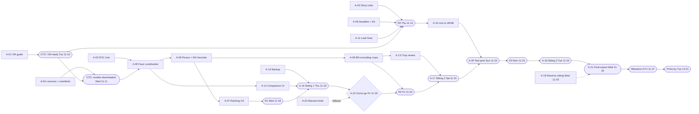

# Backlog v2: Track A (holiday release) and Track B, re-cut around the CTO decisions

| | |
|---|---|
| **Author** | Tech Lead |
| **Date** | 2026-11-07 (Saturday) |
| **Status** | **Architect-approved (2026-11-07)**, with the changes in the review below. **Replaces** the sprint 1–3 plan in [backlog draft v1](2026-11-backlog-draft.md); v1's epics (§4) still stand for Track B after Dec 1. **Nothing has been created on GitHub yet.** |
| **Sources** | [CTO decisions C1–C10](../decisions/2026-11-07-cto-decisions.md) (these override earlier plans), [backlog draft v1](2026-11-backlog-draft.md) with its Architect and PM reviews, [kickoff minutes](../meetings/2026-11-07-kickoff.md) (D1–D14), [POC README](../../../poc/README.md), [POC handoff](../../../poc/HANDOFF.md), [spec v1.2](../../spec/technical-specification.md), [`.github/labels.json`](../../../.github/labels.json) |

Local IDs (`A-xx` for Track A, `B-xx` for Track B, and v1's `S1-xx`/`S2-xx` where an item carries over) are placeholders. When the issues are created, each body gets its real `#number`, and references between issues are rewritten to match.

---

## Architect review (2026-11-07)

**Approved.** The changes below are part of the plan.

**Answers to §6**

| Q | Decision |
|---|---|
| Q1 Merge path | **Approved: integration branch `release/holiday-2026`.** Track A PRs target it. The Tech Lead merges a PR into it once the PR gate passes (all labels, CI green). The VM operator pulls only tags cut from that branch. The CTO merges `release/holiday-2026` into `main` at least at the go/no-go (Fri 11-20) and after the final export, or whenever they choose. `main` keeps its protection and only the CTO merges there. The CTO can veto this process change. |
| Q2 VM to USB | **Approved: RDP local-drive redirection**, turned on only for the two export sessions (A-20, A-21), and recorded in A-01. The Azure Bastion native client's file transfer is the alternative. Exported files pass through the CTO's own PC on the way to USB; the A-21 checklist deletes that local copy after the USB copy is verified. |
| Q3 Model hashes | **Approved: trust on first use, confirmed twice.** Record the source URL, model version and SHA-256 at the first download on the VM. A second, independent download on a different day must match before run R1. Security signs off the manifest (A-04). A mismatch stops the run. |
| Q4 ADR-0009 and spec v1.2 | **Already written** in commit 6d71070, together with the CTO decisions. **B-02 is closed.** **B-01 becomes a PM review** of spec v1.2, plus two follow-ups: scope §18.4's labels to the Track B event (C5), and decide whether M4's full-event run stays Japan 2024. A-01, A-06, A-07 and A-08 cite spec §8.4, §8.6, §10.3 and §12.4 step 4a. |

**Changes to issues**

- **A-02 is partly delivered.** `.claude/settings.json` (deny Read on photo and video extensions, OneDrive, `~/Pictures` and app-data paths) and the AGENTS.md rule "never read photo data" are already committed. A-02 extends the file with Edit/Write denials, `*.png`, `*.db` and export-folder paths, and adds the VM-only command template and the guard test. Keep the committed rules path-based, as the Tech Lead proposed.
- **A-01 gains a licence fallback.** If Windows 11 isn't eligible on the CTO's Azure tenant (risk R2), use **Windows Server 2022 with Desktop Experience**, where the licence is included in the VM price. The guide must verify on the VM that OneDrive Files On-Demand, PySide6 and MediaPipe work there before R0. If they don't, escalate to the Architect the same day.
- **A-05 and A-06 detector evidence.** The early-warning check on Mon 11-16 must report, from synthetic fixtures and from reason-code counts only: face recall on small faces (separately), blink-score sanity on the closed-eyes fixture, and person-detector recall on small background people. A miss on two of the three triggers YOLOX standby or the A-23 fallback at the go/no-go.
- **A-07 ranking.** The C9 criteria are spec §8.4 and §10.3. Weights are versioned configuration owned by the Data Scientist, and every pick shows its reasons in the UI, so the CTO's override reason codes can be traced to a criterion.

**Process notes**

- Track A PRs still pass the PR gate. For Track A only, the QE pre-review is time-boxed to half a day (as the plan says). The gate itself is not relaxed.
- Weekend sittings (Sat 11-21) and the Sun 11-22 test print depend on the CTO, who set no time limits but asked for minimal involvement. The PM confirms these dates with the CTO on Mon 11-09.

---

## 0. What changed, and the rules for this plan

**The CTO decisions in one paragraph.** There are now two tracks (C1). **Track A** hardens the POC, which stays in `poc/`. It runs fully locally (C2) on an Azure Windows 11 VM in the CTO's subscription (C3). It processes Japan 2024 and exports printable 4×6 JPEGs by **Fri 2026-11-27**, so prints can be made at a Walgreens kiosk or from USB by **Tue 2026-12-01** (C7). The CTO sees AI picks for Japan 2024 (C5), so D1 no longer applies to that event; the unbiased baseline and labels move to a different, later Track B event. "No random people in the background" is a size, sharpness and position heuristic, never identity (C4). Claude Code may run on the VM, with deny rules, and agents only ever see aggregates (C6). **Track B** (the production app per spec) continues with whatever capacity Track A leaves, and becomes the main track after Dec 1.

**Rules of this plan**

1. **Track A wins every conflict** over people, review time, CI time and the CTO's attention. A Track B issue that blocks a Track A issue is paused, not the other way round. Every Track A issue carries a `track:A` note in its body. There is no `track:*` label; adding one would need a `labels.json` PR, and the milestone already tells the tracks apart.
2. **Agents never read photos (C6).** No agent receives a photo, thumbnail, crop, screenshot, path, folder name, file name, capture time, GPS value, content hash or label file from Japan 2024. The pipeline is operated through commands that print aggregates only (A-11). Tuning uses the CTO's **reason codes** (aggregate counts) and synthetic fixtures, never a look at the photos.
3. **Japan 2024 is the only event the VM processes before the Track B baseline** (C5). If AI output were run on any other event, that event could no longer be the Track B evaluation event.
4. **Developing without model weights.** The build container can't download model files (POC README finding 1), and weights are never in git. So CI tests ranking, heuristics and crops against **stubbed detector outputs**. Tests that need the real models are marked `models` (registered in `poc/tests/conftest.py`), and the operator session runs them on the VM on synthetic images only, with each run logged. This is a known coverage gap; every PR states it.
5. **The VM session is an operator, not a developer.** Code is written in the normal cloud sessions and merged through the PR gate. On the VM, Claude Code only pulls a tagged commit, installs from the lock file, runs the allowlisted commands and reports aggregates (A-02).
6. **Definition of done (unchanged from v1, not repeated per issue).**
   - *Not tested:* the PR states what was **not** run on the VM or on real iPhone files.
   - *Gates:* `ruff check .` and `pytest` (including `CI / poc`) are green on Python 3.12. AGENTS.md non-negotiables apply. The QE pre-reviews tests (one-day time-box; Track A is time-boxed to **half a day**). Systems reviews QE-authored PRs, and the Architect gates PRs the Tech Lead writes. `models/manifests/` and AGENTS.md changes need `approved:architect`.
   - *Reporting line (C8):* Systems, QE, UX and Security report to the Tech Lead. The PM, the Tech Lead and the DS report to the Architect. A Security veto goes to the Architect.

**Sprint calendar.** Sprints are one week, Monday to Friday, closed by the Friday written status (D14). Thanksgiving is Thu 2026-11-26; the CTO is assumed unavailable that day. Agents are not.

| Sprint | Dates | Track A focus | Track B share of engineering |
|---|---|---|---|
| 1 | Mon 11-09 to Fri 11-13 | VM, guardrails, models, POC hardening; run R0 | ~15% |
| 2 | 11-16 to 11-20 | Detectors, ranking, crops, colour, UI; runs R1 and R2; sittings 1–2; go/no-go Fri | ~10% |
| 3 | 11-23 to 11-27 | Test-print fixes, sitting 3, final export; **Milestone A Fri 11-27** | ~60% (after the Mon fixes) |
| 4 | 11-30 to 12-04 | Prints by Tue 12-01; Track A retro | ~95% (Track B is the main track) |

---

## 1. Milestones

GitHub milestones stay one per issue, with sprints tracked on the Project iteration field (v1 Q5, approved). **A — Holiday release** is added alongside M0–M4. Every Track A issue goes to milestone A. M1 onward are provisional and get replanned at the M0 exit.

| Milestone | Title | Due | Exit criteria | Why this date |
|---|---|---|---|---|
| **A** | A — Holiday release | **Fri 2026-11-27** (firm) | 1. Every exported photo was approved by the CTO, and every borderless crop was approved or adjusted by the CTO. No unreviewed crop is exported. 2. 1800×1200 / 1200×1800 sRGB JPEGs with an embedded sRGB profile and no EXIF or GPS; 100% pass the re-decode verification (spec §13.8). 3. `integrity` reports **0** changed originals for Japan 2024. 4. The 5-photo Walgreens test print passed (colour, trim, orientation), and its fixes were applied before the final export. 5. The export folder holds output names and opaque IDs only (D7). The print set is on the CTO's USB stick, ready for the kiosk. 6. Agent safety held: deny rules were active for every VM session, and a Security spot check of the VM session transcripts found no path, file name or image content (C6). 7. The aggregate run report is committed (A-15). | Set by the CTO (C1). Prints are due Tue 12-01, and Fri 11-27 leaves four days for the kiosk run, including a weekend. The final export is planned for **Wed 11-25**, so Fri 11-27 is buffer. |
| M0 | M0 — Environment and feasibility | **Fri 2026-12-18** | Unchanged (spec §20): the sample processes locally without hydration or crashes; the model shortlist is chosen on evidence; target values are set. The **baseline and labels are on the Track B evaluation event**, not Japan 2024 (C5). | Track A takes sprints 1–3. M0 needs the new event chosen (B-12), the benchmark harness and run, the baseline, and three labelling sittings. That's three weeks of mostly Track B capacity (Dec 2–18), finishing before the holiday window the PM asked about (v1 PM Q6). |
| M1 | M1 — Safe ingestion and first usable review | 2027-01-22 *(provisional)* | Unchanged: the CTO curates a 300–500 photo batch of the Track B event faster than with Windows Photos; zero source changes. | v1 planned six weeks of engineering from Nov 9. About 2.5 weeks went to Track A and about 2 weeks go to the holidays, so the pilot lands about five weeks later. The date depends on the CTO's January availability (still open with the PM). |
| M2 | M2 — Local AI and recommendation engine | 2027-03-05 *(provisional)* | Unchanged. | v1 date + 4 weeks, the same slip as M1 less one week. Track A's MediaPipe evidence (A-05, A-06) should shorten the M0 model shortlist, but the plan doesn't bank on that. |
| M3 | M3 — Smart cropping (parallel) | 2027-03-19 *(provisional)* | Unchanged. | v1 date + 4 weeks. It still starts when the decoding contract and geometry types are stable. A-08's background-exclusion search is input. |
| M4 | M4 — Export and full pilot | 2027-04-09 *(provisional)* | Unchanged, except that the quality targets are measured on the Track B event. Whether the full-event run stays Japan 2024 is the PM's call in spec v1.2 (B-01). | v1 date + 4 weeks. A-10 (`nclx` colour) and A-20 (lab trim) de-risk WP-10. |

---

## 2. Track A issues (fully specified)

There are 23 issues. Nine need the CTO (`needs:owner`): **A-01, A-04, A-15, A-16, A-17, A-18, A-19, A-20, A-21**. A-22 (go/no-go) is decided by the Architect and the Tech Lead, and the CTO is told the same day.

| ID | Title | Role | Size | Sprint | CTO |
|---|---|---|---|---|---|
| A-01 | VM setup guide and data-handling checklist | Systems, Security | S | 1 | **yes** |
| A-02 | Claude Code deny rules and the VM operator policy | Security | S | 1 | — |
| A-03 | Hashed POC lock file with MediaPipe, for the VM | Systems | S | 1 | — |
| A-04 | Model licence check, SHA-256 manifests, one-time download | Security, DS | S | 1 | **yes** |
| A-05 | Detector swap: MediaPipe Face Landmarker replaces Haar | DS | M | 1–2 | — |
| A-06 | Person and pet detector, and the background-people heuristic | DS | M | 2 | — |
| A-07 | Ranking per C9 | DS | M | 2 | — |
| A-08 | Crops that exclude background people | QE (DS reviews) | M | 2 | — |
| A-09 | Worker deadline and kill for hung decodes | Systems | M | 1 | — |
| A-10 | `nclx`/Display P3 to sRGB | Systems | M | 2 | — |
| A-11 | Leak fixes (D6/D7) and aggregate-only command output | QE | S | 1 | — |
| A-12 | UI comparison view | UX | M | 2 | — |
| A-13 | UI crop review queue | UX | M | 2 | — |
| A-14 | Decision backup and restore on the VM | Systems | XS | 1 | — |
| A-15 | Japan 2024 runs (R0–R3) with aggregate report | Systems | S | 1–3 | **yes** |
| A-16 | CTO sitting 1: picks | PM, UX | XS | 2 | **yes** |
| A-17 | CTO sitting 2: picks round 2, first crops, test-print choice | PM, UX | XS | 2 | **yes** |
| A-18 | CTO sitting 3: crop sign-off and print-set lock | PM, UX | XS | 3 | **yes** |
| A-19 | CTO sitting 4 (reserve) | PM, UX | XS | 3 | **yes** |
| A-20 | Test export and 5-photo Walgreens test print | QE, PM | S | 2–3 | **yes** |
| A-21 | Final export and hand-off to USB | Systems, QE | S | 3 | **yes** |
| A-22 | Go/no-go checkpoint (Fri 11-20) | Tech Lead, Architect | XS | 2 | informed |
| A-23 | Contingency: manual review mode in the existing UI | UX | S | 1–2 | — |

---

### A-01 — VM setup guide and data-handling checklist (C3, C6)

**Labels:** `role:systems`, `role:security`, `wp:WP-0`, `type:docs`, `size:S`, `status:ready`, `needs:owner`, `needs:security`
**Milestone:** A · **Sprint:** 1 (merge **Mon 11-09**; CTO provisions **Tue 11-10**) · **Depends on:** — · **Blocks:** A-04 (download step), A-15, all VM work

#### Goal
The CTO can stand up a locked-down Windows 11 VM in one sitting, sync Japan 2024 onto it, and know exactly what may and may not leave it.
#### Scope
- In: `docs/ops/track-a-vm-setup.md`, a step-by-step guide with a checklist the CTO ticks:
  - **VM:** Windows 11 Enterprise, Trusted Launch, 8 vCPU / 32 GB RAM class (Systems recommends a size and gives a monthly cost estimate for the CTO to approve), a Premium SSD sized from the Japan 2024 total plus 2× for the cache, no public IP (Azure Bastion with the native RDP client, or just-in-time RDP), MFA, a budget alert on the subscription, and auto-shutdown at a fixed late hour. The POC resumes after a shutdown, so a shutdown during a run only delays it.
  - **RDP quality:** 32-bit colour, "LAN" experience setting, so blinks and softness can be judged on screen.
  - **Photos:** OneDrive signed into the CTO's account. Only the Japan 2024 folder is pinned ("Always keep on this device") and fully synced before R0, as the CTO's own action (C3, C5).
  - **App:** Python 3.12, the repo at a tagged commit, a venv installed from the A-03 lock only, and the data directory under `%LOCALAPPDATA%\FamilyPhotoCurator-POC`, outside every OneDrive root.
  - **Models:** the A-04 download-and-verify step.
  - **Claude Code:** installed with the A-02 policy files before the first agent session.
  - **Export path:** a local export folder outside OneDrive; the VM-to-USB route per Architect Q2.
  - **After Dec 1:** retention. The data directory, export folder and VM are kept until the CTO decides, and are deleted with a documented step (no snapshots or backups of the photo disk without the CTO's say).
- In: a **data-handling checklist** replacing v1's S1-01 for the VM: allowed out = counts, rates, timings, error-class histograms, and reason-code counts. Forbidden out = everything in rule 2 of §0. A sign-off line per sitting.
- Out: Track B's checklist for the new event (B-12 reuses this one); the VM itself (the CTO creates it).
#### Acceptance criteria
- [ ] The guide is committed, and Security has reviewed it for C3, C6 and C7.
- [ ] Every step is either a command whose output is shown, or a portal click-path; no step needs an agent to see the screen.
- [ ] The guide states that only the Japan 2024 roots are ever passed to the POC on this VM (C5).
- [ ] It states that no Azure AI or LLM service is installed or called, and the app's socket guard stays on (C2, ADR-0001).
- [ ] The CTO records on this issue: VM created, size and cost approved, Japan 2024 pinned and synced, and checklist signed (date and initials only).
- [ ] A synthetic smoke run (`poc/tools/make_sample_event.py`) on the VM passes, and `pytest poc/tests` is green there.
#### Notes
- `track:A`. Links: C2, C3, C6, C7; ADR-0001, ADR-0004, ADR-0009 (see Architect Q4); spec §16.
- Windows 11 on Azure needs an eligible licence (Windows Enterprise E3/E5 or Microsoft 365 rights). The CTO confirms this in the cost step. If it's not available, see risk R2.
- Size: S, because it is prose plus a few scripts. Biggest risk: OneDrive sync time for Japan 2024. Mitigation: start the sync on Tue 11-10.

---

### A-02 — Claude Code deny rules and the VM operator policy (C6)

**Labels:** `role:security`, `wp:WP-11`, `type:chore`, `size:S`, `status:ready`, `needs:architect`
**Milestone:** A · **Sprint:** 1 (merge **Tue 11-10**) · **Depends on:** — · **Blocks:** A-15 and any Claude Code session on the VM

#### Goal
A Claude Code session on the VM can't read photos or app data, and can run only the commands that print aggregates without asking the CTO.
#### Scope
- In: a committed `.claude/settings.json` with path-based `deny` rules that are harmless in any environment:
  - `Read`/`Edit`/`Write` on the POC data directory, any `OneDrive` tree, `**/print_ready/**`, `**/manifests/**` and `**/reports/**` under an export root, and image and database extensions (`*.heic`, `*.heif`, `*.jpg`, `*.jpeg`, `*.png`, `*.db`).
  - Bash access to `sqlite3`, image viewers, and network tools (`curl`, `Invoke-WebRequest`, `scp` and similar).
- In: a **VM-only policy template** (`docs/ops/claude-settings-vm.template.json`), installed by A-01 as the machine's managed settings, with:
  - an allowlist: `git fetch/checkout` of tags, `pip install --require-hashes -r …`, the A-11 `python -m fpc_poc` subcommands, `pytest poc/tests`, `ruff check`;
  - everything else set to *ask* (the CTO approves);
  - placeholders only for the real photo root. The real path is filled in on the VM and **never committed** (folder names are forbidden out, D2).
- In: an AGENTS.md rule: "On the VM, agents operate the POC only through aggregate-only commands; never read photos, app data or exports, and never take screenshots."
- In: a test that loads both files and asserts that the required deny entries are present, so later edits can't drop them.
- Out: OS-level isolation (a separate Windows user without NTFS read access to photos). This is possible later, but it would stop the operator session from running the pipeline.
#### Acceptance criteria
- [ ] On the VM, a denied `Read` of a synthetic `.jpg` placed in the data directory is refused (logged on the issue).
- [ ] A non-allowlisted Bash command prompts instead of running (logged on the issue).
- [ ] The POC UI's `screenshot` option is disabled or refused on the VM (`ui.run_ui(screenshot=…)`).
- [ ] The guide states plainly that deny rules are guardrails, not a sandbox. The controls are the aggregate-only output (A-11), the ask-by-default policy, and the Security spot check at Milestone A.
- [ ] The Architect approves the AGENTS.md change.
#### Notes
- `track:A`. Links: C6; AGENTS.md; spec §16.
- Size: S. Biggest risk: deny patterns that are too broad slow down development agents in the build container. Mitigation: the committed rules are path-based; command restrictions live only in the VM template.

---

### A-03 — Hashed POC lock file with MediaPipe, for the VM

**Labels:** `role:systems`, `wp:WP-0`, `type:chore`, `size:S`, `status:ready`, `needs:security`
**Milestone:** A · **Sprint:** 1 (merge **Tue 11-10**) · **Depends on:** — · **Blocks:** A-05, A-06, A-15

#### Goal
The VM installs exactly the reviewed package versions, including MediaPipe, with no resolver surprises.
#### Scope
- In: `poc/requirements-lock.txt` with hashes for Windows and Python 3.12, adding `mediapipe` to the current POC requirements. CI `poc` job installs from it with `--require-hashes`.
- In: a dependency check of `mediapipe` against the POC's pins (`numpy`, `opencv-python-headless` vs `opencv-contrib-python`, `protobuf`), resolved so only one OpenCV distribution is installed.
- Out: the `src/` lock (v1 S1-02, now B-05).
#### Acceptance criteria
- [ ] `pip install --require-hashes -r poc/requirements-lock.txt` succeeds on `windows-latest` and on the VM.
- [ ] Exactly one `cv2` distribution is installed; `pytest poc/tests` is green with the lock.
- [ ] Security has reviewed the added packages and their licences (MediaPipe is Apache-2.0), and confirmed that no Azure or other cloud SDK is pulled in (C2).
- [ ] The PR states the `mediapipe` version and that it has a `cp312-win_amd64` wheel.
#### Notes
- `track:A`. Links: v1 S1-02 (carried forward as B-05 for `src/`); C2.
- Size: S. Biggest risk: MediaPipe's pins conflict with OpenCV or NumPy. Fallback: run the person detector through YOLOX ONNX on OpenCV DNN (A-06), and keep MediaPipe for faces only.

---

### A-04 — Model licence check, SHA-256 manifests and one-time download on the VM (ADR-0007, C9)

**Labels:** `role:security`, `role:data-scientist`, `wp:WP-0`, `type:chore`, `size:S`, `status:ready`, `needs:architect`, `needs:security`, `needs:owner`
**Milestone:** A · **Sprint:** 1 (verdicts **Mon 11-09**, download **Wed 11-11**) · **Depends on:** A-01 (download step) · **Blocks:** A-05, A-06

#### Goal
The POC loads only models that Security has cleared for personal use and that match a committed SHA-256.
#### Scope
- In: written licence verdicts (code, weights, training-data terms) for personal use (C9 answers §22.7) for: the MediaPipe Face Landmarker bundle (`face_landmarker.task`), the MediaPipe Object Detector with EfficientDet-Lite2 (and Lite0 as the speed fallback), YOLOX-S ONNX as the person-detector fallback, and YuNet (OpenCV Zoo) as the reserve face detector (risk R4). These go into `docs/security/model-licence-verdicts.md`, which B-11 extends later.
- In: one manifest per cleared model in `models/manifests/` (ADR-0007): id, version, source URL, licence, verdict link, SHA-256, size, input and output contract, and `hash_source`.
- In: `poc/tools/fetch_models.ps1`, run **by the CTO** on the VM. It downloads each file once into `models/weights/` (git-ignored), prints and checks its SHA-256 against the manifest, and refuses a mismatch. Network code lives in this ops script only, never in `poc/fpc_poc` or `src/`.
- In: a `.gitignore` entry for `*.task` and `*.tflite`.
- Out: the other v1 S1-09 candidates (B-11); bundling or distribution.
#### Acceptance criteria
- [ ] Each manifest links to a written verdict, and the verdict is recorded before any download (Security round 1).
- [ ] The POC loader refuses any model file that has no manifest entry or whose hash doesn't match (test with a stub file). This replaces today's `models/face_detection_yunet*.onnx` glob in `features.py`.
- [ ] The CTO records on the issue that `fetch_models.ps1` ran and all hashes matched.
- [ ] `git status` on the VM shows no weight files, and `.gitignore` covers every format in the manifests.
#### Notes
- `track:A`. Links: ADR-0007; C9 (§22.7 personal use); D10.
- Upstream doesn't publish SHA-256 values for the MediaPipe files, so the first hash is trust-on-first-use (Architect Q3).
- Size: S. Biggest risk: a training-data term that turns amber. Fallback: YOLOX for people, YuNet for faces (no blink or pose signals, so blink falls back to the POC's crude proxy), and A-23 beyond that.

---

### A-05 — Detector swap: MediaPipe Face Landmarker replaces Haar

**Labels:** `role:data-scientist`, `wp:WP-7`, `type:feature`, `size:M`, `status:blocked`
**Milestone:** A · **Sprint:** 1–2 (merge target **Fri 11-13**, VM-validated **Mon 11-16**) · **Depends on:** A-03, A-04 · **Blocks:** A-06, A-07, A-08, A-12

#### Goal
Faces, blinks and head pose come from a landmark model instead of Haar, so false "faces" in backgrounds stop lowering good photos and causing false crop conflicts (POC finding 1).
#### Scope
- In: `features.py` uses the MediaPipe Face Landmarker (Tasks API, `num_faces` ≥ 10, blendshapes and the facial transformation matrix on). Per face it records:
  - a normalised box,
  - `blink_left`/`blink_right` (from `eyeBlinkLeft`/`eyeBlinkRight`),
  - yaw, pitch and roll (from the transformation matrix),
  - detector confidence,
  - face sharpness (Laplacian variance on the face region, normalised by face size).
- In: a **two-resolution pass**, because the Landmarker's face detector is short-range and misses small faces on the 1024 px derivative. Every photo is analysed at 1024 px. Photos in the candidate set (recommended or in a multi-photo group) are re-analysed at 2048 px. A-06 adds person-box crops from the 2048 px image.
- In: Haar code paths removed, including Haar eyes and Haar cats (pets move to A-06). `detector` is set to `"mediapipe-face-landmarker-<ver>"`, and the feature cache is invalidated when it changes.
- In: the socket guard stays on in every worker, and a test shows the model loads with the guard on.
- Out: the person detector (A-06); ranking changes (A-07); production WP-7.
#### Acceptance criteria
- [ ] CI: unit tests on stubbed Landmarker output cover blink, pose and box conversion, including rotated (EXIF 6/8) derivatives.
- [ ] VM (`-m models`, synthetic images only): on the scikit-image `astronaut` image, one face is found with both blink scores below 0.3 and |yaw| below 20°. On a blank or texture image, no face is found. The results are logged on the issue.
- [ ] R1 aggregates (A-15) report faces per photo and the share of photos with at least one face, at 1024 px and 2048 px, next to R0's Haar numbers. No per-photo data.
- [ ] Analysis time per photo is reported for both passes; a full Japan 2024 pass fits overnight.
#### Notes
- `track:A`. POC reference: `poc/fpc_poc/features.py` (`_detect_faces`, `_cascades`, `compute`). Architect direction: MediaPipe Face Landmarker, Apache-2.0.
- MediaPipe runs on TFLite, not ONNX (ADR-0002). This is POC-only; production adoption is a Track B decision at the M0 shortlist.
- Size: M. Biggest risk: recall on small faces in group shots. Mitigation: the 2048 px pass and the A-06 per-person crops.

---

### A-06 — Person and pet detector, and the background-people heuristic (C4)

**Labels:** `role:data-scientist`, `wp:WP-7`, `type:feature`, `size:M`, `status:blocked`
**Milestone:** A · **Sprint:** 2 (merge **Tue 11-17**) · **Depends on:** A-05 · **Blocks:** A-07, A-08

#### Goal
Every person in a photo is classed as a main subject or a background person by size, sharpness and position alone, so ranking can penalise background people and crops can exclude them.
#### Scope
- In: the MediaPipe Object Detector with EfficientDet-Lite2 (COCO `person`, `cat`, `dog`) on the 1024 px derivative, plus a 2×2 tiled pass on the 2048 px image for candidate photos, to find small people. YOLOX-S ONNX on OpenCV DNN sits behind the same function as the fallback (A-03, A-04).
- In: for each person box in a candidate photo, a head-region crop from the 2048 px image is passed to the Face Landmarker, and the faces are merged with A-05's faces by IoU.
- In: the **C4 heuristic**, with versioned, uncalibrated thresholds in `config.py`:
  - *Main subjects* are the largest, sharpest cluster of people. All people of similar size near each other are main subjects.
  - A person is *background* if their box height is below α × the median main-subject height, **and** at least one of: sharpness below β × the main-subject sharpness, or distance from the main cluster above γ × the main-subject height.
  - Output: `main_subjects`, `background_people` (box, area share, reason flags), and `pets`.
- Out: any identity, face embedding or clustering (AGENTS.md, C4); ranking weights (A-07).
#### Acceptance criteria
- [ ] Unit tests on synthetic box layouts: a single family group gives no background people. A small, soft figure behind the group is background. Two equal-size people far apart are both main subjects. With no people, both lists are empty.
- [ ] A grep test shows that no face embedding, descriptor or identity API is imported (AGENTS.md).
- [ ] VM (`-m models`): on a synthetic composite (a large and a small scikit-image person cut-out on a background), one main subject and one background person are found (logged).
- [ ] R1 aggregates: distribution of people per photo, share of photos with at least one background person, and pets per photo.
- [ ] Thresholds α, β and γ and the heuristic version are in config, and each feature record carries the version.
#### Notes
- `track:A`. Links: C4; spec §2.3, §16.3 (unchanged). Architect direction: MediaPipe Object Detector (EfficientDet-Lite, Apache-2.0) or YOLOX ONNX.
- The heuristic fails open: a missed background person gets no penalty, and the CTO catches it in review with reason code `BG` (A-12), which feeds tuning.
- Size: M. Biggest risk: EfficientDet-Lite misses small, distant people. Mitigation: the tiled pass; switch to YOLOX if R1 shows few detections on candidate photos.

---

### A-07 — Ranking per C9

**Labels:** `role:data-scientist`, `wp:WP-8`, `type:feature`, `size:M`, `status:blocked`
**Milestone:** A · **Sprint:** 2 (merge **Wed 11-18**, before R1) · **Depends on:** A-05, A-06 · **Blocks:** A-15 (R1), A-16

#### Goal
The best frame in each group, and the recommended print set, follow the CTO's criteria: forward-facing family moments, no blinking, sharp, decent background, and no unrelated people unless a crop removes them.
#### Scope
- In: `ranking.score` rewritten with versioned weights in config, and a reason for each component:
  - **Eyes:** a penalty for each main-subject face with a blink score over threshold; group shots are scored by the worst face.
  - **Facing:** forward-facing from |yaw| and |pitch|, scored by the worst main-subject face.
  - **Sharpness:** main-subject face sharpness, or global sharpness when there are no people.
  - **Exposure:** unchanged.
  - **Background:** a penalty for each background person, scaled by area share. The penalty is reduced if A-08 can crop them out without a conflict. A small clutter term (edge density outside the subject boxes).
- In: `recommend` changes. The people bonus is removed, because C9 sets no preference between people and scenery; scenery photos rank on sharpness, exposure and composition. The default target becomes "every group whose best frame clears a quality bar, at most 1 per group (2 for long groups)", since there's no budget limit (C9). The bar is in config.
- In: reasons readable in the comparison view, for example "eyes closed (1 of 4)", "looking away", "background person, can crop", "background person, can't crop".
- Out: preference fitting on labels (Track B, WP-8). Weights are tuned only from the CTO's reason-code counts after sitting 1.
#### Acceptance criteria
- [ ] Tests on stubbed features: a burst where one frame has a blinking face ranks that frame below its eyes-open siblings, keeping the POC's `test_e2e_burst_blink_not_chosen` behaviour. Eyes-open + forward ranks above eyes-open + looking away. A background person who can be cropped is penalised less than one who can't. A sharp no-people landscape is recommended when it clears the bar (no people preference).
- [ ] The weights version is stored with each score. Re-ranking keeps all CTO decisions (decisions are inputs; ADR-0008).
- [ ] The PM confirms on the issue that the component list matches C9, including the operational meaning of "decent background".
- [ ] R1 aggregates: recommended count, share per reason, and number of groups.
#### Notes
- `track:A`. POC reference: `poc/fpc_poc/ranking.py`. Links: C9 (§22.5, §22.10); spec §8, §10.
- Not an evaluation: Japan 2024 has no unbiased labels (C5). Metrics wait for Track B.
- Size: M. Biggest risk: we tune blind. Mitigation: reason codes give a per-reason error count without anyone seeing photos.

---

### A-08 — Crops that exclude background people

**Labels:** `role:quality`, `role:data-scientist`, `wp:WP-9`, `type:feature`, `size:M`, `status:blocked`
**Milestone:** A · **Sprint:** 2 (merge **Thu 11-19**, before R2) · **Depends on:** A-06 · **Blocks:** A-13, A-15 (R2), A-20

#### Goal
The proposed 4×6 crop keeps every main subject and pet inside the safe margin and pushes background people out of frame where that's possible.
#### Scope
- In: `crop.propose` takes main-subject faces and bodies (hard protected), pets (protected, lower weight than faces, as today), and background people (**negative** regions). It searches the free axis and a small set of zoom levels (1.0 down to the largest zoom that keeps the crop's short side ≥ 1200 px, spec §13.4) and scores by: no clipped main-subject face (hard), background area remaining in the frame (minimise), safe margin, and saliency coverage.
- In: new risk reasons: `bg_person_removed`, `bg_person_kept` (needs review), `low_res_after_zoom` (needs review).
- In: the crop uses high-resolution boxes from A-05 and A-06 for candidate photos (spec §12.4), not the 1024 px boxes.
- Out: manual editing (exists; A-13 improves it); bordered fit (unchanged, still available per photo).
#### Acceptance criteria
- [ ] The §12.3 invariant still holds over the 200-seed random test, now with zoom levels and negative regions added.
- [ ] A background person at one edge is excluded when a valid crop keeps all main subjects. When it can't be, the crop keeps the subjects and is marked `needs_review` with `bg_person_kept`.
- [ ] Zoom never drops the crop's short side below 1200 source pixels; there is no upscaling.
- [ ] Manual crops are never recomputed (POC behaviour kept). Re-proposal after a model change flags the crop for re-confirmation (spec §12.8).
- [ ] R2 aggregates: risk-class histogram and reason counts.
#### Notes
- `track:A`. POC reference: `poc/fpc_poc/crop.py`, `pipeline.propose_crops`. Links: C4; spec §12.
- The QE implements as general implementer (v1 Q4 precedent), the DS reviews the scoring, and Systems reviews the PR (D14).
- Size: M. Biggest risk: zoom crops that look cramped. Mitigation: zoom is capped (config) and every zoomed crop is shown first in A-13's queue.

---

### A-09 — Worker deadline and kill for hung decodes

**Labels:** `role:systems`, `wp:WP-3`, `type:feature`, `size:M`, `status:ready`, `needs:security`
**Milestone:** A · **Sprint:** 1 (merge **Wed 11-11**, before R0) · **Depends on:** — · **Blocks:** A-15

#### Goal
A file that hangs a decoder, a model call or an export can't stall the Japan 2024 run (POC finding 5).
#### Scope
- In: `decode.run_isolated` moves from `ProcessPoolExecutor` to managed worker processes with a per-task deadline. The defaults are 30 s for decode (D4) and 60 s for feature tasks, both in config. On expiry the worker is killed and respawned, and the item is marked `timeout`. A second timeout or crash marks it `quarantined`, and it is skipped on later runs until the decoder version changes. The 120 MP cap is kept.
- In: the same mechanism for ingest, features and export.
- In: a hang variant of the existing POC fault marker for tests. This is POC-only, as D5 allows ("the POC keeps its marker"), and it is never ported to `src/`.
- Out: the production decoder pool (v1 S2-03, Track B).
#### Acceptance criteria
- [ ] A hanging item returns `timeout` within the deadline plus a 5 s grace period, and every other item completes (end-to-end test on the synthetic event).
- [ ] A second strike gives `quarantined`, and a rerun skips the item.
- [ ] A kill mid-run, then a rerun, processes only the pending items (the POC resume test still passes).
- [ ] The `status` aggregates include `timeout` and `quarantined` counts.
#### Notes
- `track:A`. POC reference: `poc/fpc_poc/decode.py` (`run_isolated`, `task_ingest`). Links: D4, D5; ADR-0003.
- The experience feeds the WP-3 low-level design (B-09).
- Size: M. Biggest risk: Windows `spawn` start-up cost with respawns. Mitigation: long-lived workers; respawn only after a kill.

---

### A-10 — `nclx`/Display P3 to sRGB

**Labels:** `role:systems`, `wp:WP-10`, `type:feature`, `size:M`, `status:ready`
**Milestone:** A · **Sprint:** 2 (merge **Wed 11-18**, before the test export) · **Depends on:** R0 aggregates (A-15) for the real `nclx` mix · **Blocks:** A-20

#### Goal
iPhone HEICs described only by `nclx` (Display P3) print with the right colours instead of being treated as sRGB (POC finding 4).
#### Scope
- In: `to_srgb` handles three cases:
  - an embedded ICC profile: unchanged;
  - `nclx` only: map the primaries and transfer function to a profile and convert to sRGB with LittleCMS, relative colorimetric with black-point compensation (spec §13.3);
  - unknown `nclx` combinations: treated as sRGB, with a counted warning, never silently.
- In: the Display P3 profile comes from a matrix and TRC profile built in code from the published primaries, or a CC0 profile file that Security clears.
- In: HDR gain maps are ignored, and the SDR base is used (spec §13.3).
- In: R0 reports the counts of ICC, `nclx`-only by primaries and transfer function, and neither.
- Out: rendering-intent studies; 16-bit paths (WP-10).
#### Acceptance criteria
- [ ] Unit test: a P3 pure red (1, 0, 0) converts to the expected out-of-gamut-clipped sRGB value within a stated ΔE tolerance, and P3 white stays white.
- [ ] If pillow-heif can write `nclx` boxes, a synthetic P3 HEIC fixture round-trips through `load_oriented` and export. If it can't, the PR says so, and the VM check is the R2 aggregate plus the A-20 test print.
- [ ] Export still embeds sRGB ICC, and verification still passes.
- [ ] R2 aggregate: the number of photos converted from `nclx`; zero unknown combinations, or each one listed by code (not by photo).
#### Notes
- `track:A`. POC reference: `poc/fpc_poc/decode.py` (`to_srgb`, `load_oriented`), `export.py`. Links: spec §13.3; HANDOFF port map (export).
- Size: M. Biggest risk: we can't see a real P3 file. Mitigation: the test print includes a saturated P3 photo the CTO picks (A-17).

---

### A-11 — Leak fixes (D6/D7) and aggregate-only command output

**Labels:** `role:quality`, `wp:WP-11`, `type:bug`, `size:S`, `status:ready`, `needs:security`
**Milestone:** A · **Sprint:** 1 (merge **Wed 11-11**, before R0) · **Depends on:** — · **Blocks:** A-15, A-20

#### Goal
Nothing the agent sees on the VM, and nothing in the export folder handed to Walgreens, contains a path, file name, capture time, source hash or message text.
#### Scope
- In: the leaks Security found:
  - `photos.error` stores the exception class and an error code, not `f"{e}"`;
  - `integrity` prints counts, and the list of changed items goes to a file in the data directory (denied to agents, A-02);
  - `run` no longer prints the data directory;
  - `export` returns counts, not the folder path;
  - `selection.csv` keeps output name, opaque ID, status and verified only (D7);
  - `crop_decisions.json` keeps opaque IDs, no `source_fingerprint`;
  - `export_summary.json` items have no paths or message text.
- In: a top-level handler in `__main__`. An uncaught exception prints its class and a code. The full traceback goes to a log file in the data directory.
- In: a `summary` subcommand: one aggregate JSON for agents, with status counts, timings, decision counts, reason-code counts and the crop risk histogram.
- Out: the production log sanitiser (WP-11).
#### Acceptance criteria
- [ ] A canary test runs the full synthetic pipeline with canary tokens in folder names, file names and EXIF, and captures stdout, stderr, the DB `error` fields and every file in the export folder. It fails on any canary hit, any absolute path, or any timestamp pattern.
- [ ] The same test passes with a forced uncaught exception (no path on stderr).
- [ ] Security confirms that the outputs of every allowlisted command in A-02 are aggregate-only.
#### Notes
- `track:A`. Links: D6 (invariant 10), D7; Security round 1; spec §13.6. POC reference: `pipeline.py` (`ingest`, `export`, `integrity`), `__main__.py`.
- This pulls forward the canary part of v1 S1-15 for the POC. S1-15's remaining suites stay in Track B (B-08), without the `xfail` cases.
- Size: S. Biggest risk: a third-party library message that includes a path (Pillow, pillow-heif). Mitigation: messages are never printed, only class and code.

---

### A-12 — UI comparison view

**Labels:** `role:ux`, `wp:WP-8`, `type:feature`, `size:M`, `status:blocked`
**Milestone:** A · **Sprint:** 2 (merge **Wed 11-18**, before sitting 1) · **Depends on:** A-05 (feature fields) · **Blocks:** A-16

#### Goal
The CTO can pick the best frame of a group in seconds, seeing the frames side by side with why the app ranked them as it did.
#### Scope
- In: the existing compare action (`C`) becomes a 2–4 up view of a group, in rank order, synchronised zoom (fit and 100%), and keys to move between frames and groups.
  - Overlays: main-subject faces in green, blink in orange, looking away in yellow, background people in red, pets in blue (HANDOFF port map colours, extended).
  - The reason line from A-07.
  - Approve or reject from the view.
- In: an optional **reason code** on reject or override, one key, from a fixed list: `BLINK`, `AWAY`, `SOFT`, `BG` (background person), `CROP`, `BETTER` (a different frame is better), `OTHER`. Reason codes are appended with the decision (append-only, ADR-0008), and `summary` reports only their counts.
- In: thumbnails load in the background so the view never blocks; prefetch the next group.
- Out: the production comparison UI (WP-8, M2); view-models and service layering (Track B).
#### Acceptance criteria
- [ ] With 4 frames of 12 MP, the next group shows within 1 s on the VM over RDP (measured with the synthetic event, logged).
- [ ] Decisions and reason codes survive a forced close and reopen.
- [ ] No reason code or overlay uses identity; the overlays draw only boxes from A-05 and A-06.
- [ ] Tests (`pytest-qt` offscreen) cover key handling and decision recording on the synthetic event.
- [ ] The PM confirms the reason-code list.
#### Notes
- `track:A`. POC reference: `poc/fpc_poc/ui.py` (compare, overlays). Links: spec §11; UX round 1 critique (synchronous reloads).
- Size: M. Biggest risk: RDP rendering lag. Mitigation: 1024 px derivatives for display; 100% zoom loads on demand.

---

### A-13 — UI crop review queue

**Labels:** `role:ux`, `wp:WP-9`, `type:feature`, `size:M`, `status:blocked`
**Milestone:** A · **Sprint:** 2 (merge **Fri 11-20**, before sitting 2) · **Depends on:** A-08 · **Blocks:** A-17, A-18

#### Goal
The CTO reviews every proposed crop in one pass, riskiest first, and approves, nudges or switches to bordered with single keys.
#### Scope
- In: a crop queue over approved photos, ordered `crop_conflict`, then `needs_review` (with `bg_person_kept` and `low_res_after_zoom` first), then zoomed, then `likely_safe`.
  - Shows the crop over the full image with the trim/safe-margin band from A-20, the risk reason, and the background-person overlays.
  - Keys: approve, drag (existing, invariant kept), bordered/borderless toggle (existing `B`), reset to proposal, and next.
  - A progress counter: reviewed / total.
- In: a crop approval or edit is appended as a decision event (append-only). The `crops` table stays the current projection.
- In: an "export-ready" count. A photo is export-ready when it is approved and its crop is approved (or it is bordered).
- Out: protected-region editing (M3).
#### Acceptance criteria
- [ ] Every edited crop passes the §12.3 invariant (existing test extended to the queue path).
- [ ] An approved photo with an unreviewed borderless crop is **not** export-ready (test). This backs exit criterion A.1.
- [ ] Queue position, approvals and edits survive a forced close (test).
- [ ] Review time per crop over RDP is logged from the synthetic run.
#### Notes
- `track:A`. POC reference: `poc/fpc_poc/ui.py` (crop drag, `toggle_border`), `crop.py`. Links: spec §12.5–12.7; ADR-0008.
- Size: M. Biggest risk: the CTO's crop volume. Mitigation: `likely_safe` crops can be bulk-approved after a quick scroll, if the PM agrees in A-17.

---

### A-14 — Decision backup and restore on the VM

**Labels:** `role:systems`, `wp:WP-1`, `type:feature`, `size:XS`, `status:ready`
**Milestone:** A · **Sprint:** 1 · **Depends on:** — · **Blocks:** A-16

#### Goal
The CTO's sitting work can't be lost to a VM or disk failure, or a bad run.
#### Scope
- In: `python -m fpc_poc backup` and `restore`. These use the SQLite backup API to a dated copy in a second local folder outside OneDrive, keep the last 10, and print counts only. The runbook calls `backup` before and after each sitting and before each run.
- Out: off-VM backup (in-tenant options are listed for the CTO in A-01, not built).
#### Acceptance criteria
- [ ] Back up, delete the DB, restore: decisions, reason codes and crop approvals are identical (test).
- [ ] A backup taken during a running pipeline is consistent (test with concurrent writes).
#### Notes
- `track:A`. POC reference: `poc/fpc_poc/db.py`. Size: XS. Biggest risk: none significant.

---

### A-15 — Japan 2024 runs (R0–R3) with aggregate report

**Labels:** `role:systems`, `wp:WP-0`, `type:spike`, `size:S`, `status:blocked`, `needs:owner`, `needs:security`
**Milestone:** A · **Sprint:** 1–3 · **Depends on:** A-01, A-02, A-03, A-09, A-11 (R0); plus A-04 to A-08 and A-10 (R1, R2) · **Blocks:** A-16 to A-21

#### Goal
Every run over Japan 2024 is done the same way, by the operator session on the VM, and only aggregates come back.
#### Scope
- In: the runs, each from a tagged commit, with `backup` before it:
  - **R0** (Thu 11-12): the hardened POC with Haar. Format and colour inventory (HEIC/JPEG share, `irot`/`imir`, ICC vs `nclx`), status counts, timeouts, timings. It is the Haar reference for A-05.
  - **R1** (Wed 11-18, overnight): detectors and ranking.
  - **R2** (Fri 11-20): sitting 1 tuning, crops and colour.
  - **R3** (Mon 11-23): test-print fixes.
- In: `docs/evaluation/track-a/japan-2024-runs.md`: one section per run with `summary` output only, the commit tag, the VM size, and the per-stage time. Security reviews each section before it is committed.
- Out: D9 benchmarks (Track B, v1 S1-10); any per-photo output.
#### Acceptance criteria
- [ ] Each run uses only the Japan 2024 roots (C5), with the A-02 policy active (recorded).
- [ ] Each run ends with `integrity` = 0 changed. Online-only files are counted, never opened (ADR-0004). The expected count is 0, because the folder is pinned.
- [ ] The report contains no path, name, timestamp, hash or per-photo value (A-11 canary rules, applied by Security).
- [ ] The run time of R1 fits a night (from start to finish, including the 2048 px pass).
#### Notes
- `track:A`. The CTO's part is starting the VM, opening the Claude Code session and approving any prompt the policy raises. Expect about 10 minutes per run.
- These runs are the evidence that "the sample processes without hydration or crashes" on the VM. They count towards M0 for Japan 2024's format inventory only, not for evaluation.
- Size: S for the team. Biggest risk: R1 is too slow for one night. Mitigation: run the 2048 px pass only for candidates; resume the next night.

---

### A-16 — CTO sitting 1: picks (Thu 11-19, about 75 minutes)

**Labels:** `role:pm`, `role:ux`, `wp:WP-8`, `type:test`, `size:XS`, `status:blocked`, `needs:owner`
**Milestone:** A · **Sprint:** 2 · **Depends on:** A-07, A-12, A-14, A-15 (R1) · **Blocks:** A-22, tuning before R2

#### Goal
The CTO reviews the recommended set and the groups, fixes the picks, and gives us the reason-code counts that drive tuning.
#### Scope
- In: a one-page sitting script (PM and UX): what to review (recommended set first, then groups with a near-tie), how to use the reason codes, and when to stop. The CTO may stop at any time.
- Out: crops (sitting 2).
#### Acceptance criteria
- [ ] `backup` is run before and after the sitting.
- [ ] Only the `summary` output leaves the VM: decision counts, override count, and reason-code counts. It is recorded on the issue.
- [ ] The DS posts the tuning change (weights or thresholds, with old → new values) on the issue before R2.
#### Notes
- `track:A`. C5 allows the CTO to see AI picks for Japan 2024. Size: XS for the team; about 75 minutes of CTO time.

---

### A-17 — CTO sitting 2: picks round 2, first crops, test-print choice (Sat 11-21, about 90 minutes)

**Labels:** `role:pm`, `role:ux`, `wp:WP-9`, `type:test`, `size:XS`, `status:blocked`, `needs:owner`
**Milestone:** A · **Sprint:** 2 · **Depends on:** A-13, A-15 (R2), A-16 · **Blocks:** A-18, A-20

#### Goal
The picks are nearly final, the crop queue is through its risky part, and the CTO chooses the five test-print photos.
#### Scope
- In: confirm the re-ranked picks (only changed groups are shown again). Review `crop_conflict` and `needs_review` crops. Choose five test photos covering: a saturated outdoor P3 photo, a borderless crop with a face near the trim line, a bordered photo, a portrait, and a zoomed crop.
- Out: final print-set lock (sitting 3).
#### Acceptance criteria
- [ ] Only aggregates leave the VM: export-ready count, crop decisions by risk class, and reason codes.
- [ ] The five test photos are flagged in the app; the flag is not exported.
- [ ] If Saturday doesn't suit the CTO, the fallback is Mon 11-23 morning, and the test print moves to Mon 11-23 evening (risk R6).
#### Notes
- `track:A`. Size: XS for the team; about 90 minutes of CTO time.

---

### A-18 — CTO sitting 3: crop sign-off and print-set lock (Tue 11-24, about 60–90 minutes)

**Labels:** `role:pm`, `role:ux`, `wp:WP-9`, `type:test`, `size:XS`, `status:blocked`, `needs:owner`
**Milestone:** A · **Sprint:** 3 · **Depends on:** A-17, A-20 (fixes applied in R3) · **Blocks:** A-21

#### Goal
Every approved photo is export-ready, and the CTO locks the print set.
#### Scope
- In: finish the crop queue on R3's proposals, re-confirm any crop flagged by the re-proposal (spec §12.8), and do a final scroll of the print set. "Lock" is a recorded decision event.
#### Acceptance criteria
- [ ] The export-ready count equals the approved count; no approved photo has an unreviewed borderless crop (A.1).
- [ ] `backup` is run after the lock; aggregates only on the issue.
#### Notes
- `track:A`. Size: XS for the team; about 60–90 minutes of CTO time.

---

### A-19 — CTO sitting 4, reserve (Wed 11-25 morning, up to 60 minutes)

**Labels:** `role:pm`, `role:ux`, `wp:WP-9`, `type:test`, `size:XS`, `status:blocked`, `needs:owner`
**Milestone:** A · **Sprint:** 3 · **Depends on:** A-18 · **Blocks:** —

#### Goal
There's a booked slot to finish sitting 3, or to re-check anything changed by a late fix, without touching Thanksgiving.
#### Acceptance criteria
- [ ] Cancelled by Tue 11-24 evening if sitting 3 finished; otherwise the same criteria as A-18.
#### Notes
- `track:A`. Size: XS. Kept as a booked hold, so it costs the CTO nothing if it isn't needed.

---

### A-20 — Test export and 5-photo Walgreens test print (export Sat 11-21, print Sun 11-22)

**Labels:** `role:quality`, `role:pm`, `wp:WP-10`, `type:test`, `size:S`, `status:blocked`, `needs:owner`
**Milestone:** A · **Sprint:** 2–3 · **Depends on:** A-10, A-11, A-17 · **Blocks:** A-15 (R3 fixes), A-18, A-21

#### Goal
We learn, five days before the deadline, whether colour, trim and orientation come out right on a real Walgreens 4×6 print.
#### Scope
- In: export the five flagged photos to a separate test folder. Copy them to USB by the Architect-approved route (Q2). The CTO prints at a Walgreens kiosk, noting the kiosk's crop or "fit" setting.
- In: a one-page **print check sheet** (PM): colour against the screen (better, same, worse); for each borderless photo, whether anything at the edges was trimmed, with the estimated trim in mm per side using a ruler against the printed safe-margin marks; orientation; whether the bordered photo kept its border.
- In: the fixes: `SAFE_MARGIN` from the measured trim (spec §12.9), and any colour fix, before R3.
- Out: online ordering (C7 prefers kiosk or USB). If online ordering is ever used, the uploaded copies are deleted after the order.
#### Acceptance criteria
- [ ] The test export passes verification: 1800×1200 or 1200×1800, embedded sRGB ICC, no EXIF or GPS, and output names and opaque IDs only in `manifests/`.
- [ ] The CTO's check sheet is recorded on the issue: ratings and millimetres only, no photo description.
- [ ] Each failed check has a fix PR merged before R3, or a written decision to accept it (PM, with the CTO).
- [ ] The kiosk setting that gave correct prints (for example "do not crop" or "fit") is written into the A-21 hand-off note.
#### Notes
- `track:A`. Links: C7; spec §13.7 (remind the user to turn off lab auto-crop), §12.9, §22.6.
- Size: S. Biggest risk: the kiosk auto-crops a 3:2 file. Mitigation: 1800×1200 is exactly 4×6 at 300 PPI; the check sheet records the setting. Fallback: bordered mode for every photo.

---

### A-21 — Final export and hand-off to USB (Wed 11-25; deadline Fri 11-27)

**Labels:** `role:systems`, `role:quality`, `wp:WP-10`, `type:chore`, `size:S`, `status:blocked`, `needs:owner`
**Milestone:** A · **Sprint:** 3 · **Depends on:** A-18 (and A-19 if used), A-20 · **Blocks:** Milestone A close

#### Goal
The locked print set is on the CTO's USB stick, verified, with a one-page kiosk note, and the originals are unchanged.
#### Scope
- In: `backup`, export of the locked set, verification, `integrity`, copy to USB via the Q2 route, and a kiosk note: file count, the kiosk setting from A-20, 4×6 glossy or matte (CTO's choice), and the reminder to turn off auto-crop. It does not list photos.
- In: the Milestone A close-out comment: the exit criteria A.1–A.7, each with its evidence.
- Out: the kiosk visit (the CTO, Sat 11-28 to Mon 11-30); retention clean-up (after Dec 1, per A-01).
#### Acceptance criteria
- [ ] 100% of outputs pass verification; the file count equals the export-ready count.
- [ ] `integrity` = 0 changed.
- [ ] The CTO confirms that the USB copy opened on a local machine and that the file count matches.
- [ ] Security's spot check of the VM Claude Code transcripts is recorded (A.6).
#### Notes
- `track:A`. Size: S. Fallback if Wed slips: Thu is unstaffed by the CTO, so the export moves to Fri 11-27 morning; Sat 11-28 is the absolute last day for a USB copy that still leaves a kiosk day before Dec 1.

---

### A-22 — Go/no-go checkpoint (Fri 11-20, 15:00)

**Labels:** `role:tech-lead`, `role:architect`, `wp:WP-0`, `type:docs`, `size:XS`, `status:blocked`
**Milestone:** A · **Sprint:** 2 · **Depends on:** A-15 (R1), A-16 · **Blocks:** A-17 (decides which mode it runs in)

#### Goal
On a fixed day, with criteria written now, we decide whether the AI path ships or whether sittings 2–3 run in manual review mode (A-23).
#### Scope
- In: a written decision on the issue, with the evidence, using these criteria. **Go** if all of these hold:
  1. R1 completed with timeouts plus quarantined items under 1% and `integrity` = 0.
  2. A-05 and A-06 VM tests passed.
  3. In sitting 1, overrides with reason `BLINK`, `AWAY` or `BG` are under 25% of reviewed groups.
  4. A-08 and A-13 are merged, or will merge by Fri evening.
  5. The CTO said the picks were helpful (a yes/no question in the sitting script).
- **No-go on the models** (any of 2 or 3 fails): the CTO reviews in A-23 manual mode. AI reasons stay hidden, crops default to bordered fit, and the CTO can still approve borderless per photo.
- **No-go on crops only** (4 fails): AI picks stay, crops default to bordered.
- Feature freeze for Track A after this checkpoint: only fixes from sittings and the test print.
#### Acceptance criteria
- [ ] The decision and the evidence are posted by 17:00 Fri 11-20, and the CTO is told the same day (PM).
- [ ] The criteria above are not changed after R1 has run.
#### Notes
- `track:A`. An early tripwire: if A-05 isn't VM-validated by **Mon 11-16 end of day**, A-23 becomes the planned path for sitting 1, and A-05 continues in parallel.
- Size: XS.

---

### A-23 — Contingency: manual review mode in the existing UI

**Labels:** `role:ux`, `wp:WP-6`, `type:feature`, `size:S`, `status:ready`
**Milestone:** A · **Sprint:** 1–2 (merge by **Fri 11-13**, so it's ready before any model work lands) · **Depends on:** — · **Blocks:** A-22 (as the fallback)

#### Goal
If a new model isn't ready or isn't good enough, the CTO can still curate Japan 2024 quickly in the existing UI and export safe prints by Nov 27.
#### Scope
- In: a `--manual` review mode:
  - capture-time order, groups as stacks with no "best" marker, and no AI scores or reasons shown;
  - Haar-based signals ignored, so false faces can't push photos down;
  - crops default to **bordered fit**, which has no trim risk, with a per-photo borderless toggle using the existing drag;
  - reason codes are still available.
- In: `export` treats bordered photos as export-ready without crop review.
- Out: any new model work.
#### Acceptance criteria
- [ ] In manual mode, no ranking, score or reason is shown (test on the synthetic event).
- [ ] Bordered exports pass verification (existing export tests, bordered path).
- [ ] Switching modes keeps all decisions (append-only; test).
- [ ] A 400-photo synthetic batch can be scrolled and decided with keys only, with no blocking reloads (logged timing).
#### Notes
- `track:A`. POC reference: `poc/fpc_poc/ui.py`, `crop.py` (bordered fit). It doubles as a useful mode if the CTO simply prefers it.
- Size: S. Biggest risk: none; this is the cheap path on purpose.

---

### Track A dependency graph

---

## 3. Track B issues (sprints 1–3, lighter specification)

### 3.1 What happens to v1's sprint 1 items

| v1 item | Verdict | Why |
|---|---|---|
| S1-01 Data-handling checklist | **Replaced** by A-01's VM checklist | C3 moves the work from the CTO's PC to the VM. B-12 reuses it for the Track B event. |
| S1-02 Hashed lock file | **Changed**: POC part pulled into A-03; `src/` part is **B-05**, sprint 3 | The VM needs the POC lock now; `src/` has no runtime users until WP-1 to WP-3 start. |
| S1-03 CI matrix, markers, nightly `slow` | **Deferred** to sprint 3 (**B-06**) | The QE is on A-08 and A-11. Today's Windows-only CI is enough for Track A. |
| S1-04 `ItemResult` + `DecoderPort` | **Stays** (**B-03**), Architect drafts; freeze moves to **Wed 11-18** | Systems is on A-09 and A-10. A-09's deadline semantics are useful input to the port. |
| S1-05 UI–service contract | **Deferred** to sprint 3 stretch (**B-13**), sprint 4 otherwise | The UX Engineer is on A-12, A-13 and A-23 until Nov 20. |
| S1-06 Baseline + pilot protocol | **Changed and deferred**: rewritten for the Track B event (**B-12**) | C5: the baseline can't be on Japan 2024, and the event isn't chosen yet. |
| S1-07 Owner-PC headless run + HEIC corpus | **Replaced** for Japan 2024 by A-15 R0; the private HEIC corpus is deferred to sprint 4 | R0 gives the format inventory. Japan 2024 HEICs are fine as a decoder corpus (no evaluation bias), kept on the VM only. |
| S1-08 OneDrive hydration test | **Changed**: runs on the VM's OneDrive client (**B-14**), sprint 3 stretch | C3 makes the VM the target machine. Track A doesn't depend on it, because Japan 2024 is pinned. |
| S1-09 Licence verdicts | **Split**: MediaPipe and YOLOX in A-04; the rest (**B-11**) in sprint 3 | §22.7 is answered as personal use (C9), so v1's family-only assumption holds. |
| S1-10 Benchmark harness | **Deferred** to sprint 4 | Systems is fully on Track A. A-15 timings are indicative only and don't replace D9. |
| S1-11 Labelling tool + protocol | **Deferred** to sprint 4 | Needs the Track B event (B-12). §22.10 is now answered by C9, which removes v1's blocker. |
| S1-12 Fixture builder | **Stays** (**B-04**), sprints 1–2, preemptible | Track A's synthetic tests benefit. It's the QE's main Track B item. |
| S1-13 Windows Photos baseline | **Deferred** (needs B-12) | C5. |
| S1-14 `CacheKey` | **Deferred** to sprint 3 (**B-07**) | Needs B-03; no consumer before WP-3 or WP-7. |
| S1-15 Integrity, privacy, canary suites | **Changed**: the POC canary part is done in A-11; the rest (**B-08**) in sprint 3 | Its `xfail` cases disappear because A-11 fixes those leaks. |
| v1 sprint 2 (S2-01 to S2-18) | **Re-planned** at the sprint 3 planning (Mon 11-23) for sprints 4–6 | Only S2-02 (B-09) and S2-04 (B-10) fit before Dec 1. |

### 3.2 Track B issues for sprints 1–3

Each one is a single PR. "Preemptible" means it pauses whenever a Track A issue needs the same person.

| ID | Title | Labels | MS | Sprint | Depends on |
|---|---|---|---|---|---|
| B-01 | Spec v1.2: C4 and C9 requirements, §22.5/§22.7/§22.10 answers, §22.6 Walgreens, D1 scoped to the Track B event | `role:pm` `role:architect` `type:docs` `size:S` `needs:architect` | M0 | 1–2 | — |
| B-02 | ~~ADR-0009 owner-controlled Azure VM~~ **Done** (commit 6d71070, Q4) | `role:architect` `type:docs` `size:S` `needs:architect` | M0 | 1 | — |
| B-03 | WP-C: `ItemResult` + `DecoderPort.decode(request, deadline)` (v1 S1-04) | `role:architect` `role:systems` `wp:WP-C` `type:feature` `size:S` `needs:architect` | M1 | 1–2 | — |
| B-04 | Seeded fixture builder + manifest + canaries + malformed corpus (v1 S1-12) *(preemptible)* | `role:quality` `role:data-scientist` `wp:WP-11` `type:test` `size:M` `needs:security` | M1 | 1–2 | — |
| B-05 | `src/` hashed lock file; CI installs pinned only (v1 S1-02, `src/` part) | `role:systems` `wp:WP-0` `type:chore` `size:S` `needs:security` | M0 | 3 | A-03 |
| B-06 | CI: Windows + Linux, markers, cache, nightly `slow` (v1 S1-03) | `role:quality` `wp:WP-12` `type:chore` `size:S` | M1 | 3 | B-05 |
| B-07 | WP-C: `CacheKey` (v1 S1-14) | `role:architect` `role:systems` `wp:WP-C` `type:feature` `size:S` `needs:architect` | M1 | 3 | B-03 |
| B-08 | Integrity, privacy and canary suites behind a runner interface (v1 S1-15, minus A-11) | `role:quality` `wp:WP-11` `type:test` `size:S` `needs:security` | M1 | 3 | B-04 |
| B-09 | WP-3 low-level design: decoder failure policy (v1 S2-02) | `role:systems` `wp:WP-3` `type:docs` `size:S` `needs:architect` | M1 | 3 | B-03, A-09 |
| B-10 | `FaultyDecoder` adapter + hang and crash contract tests (v1 S2-04) | `role:quality` `wp:WP-3` `type:test` `size:S` | M1 | 3 | B-03, B-04 |
| B-11 | Licence verdicts for the remaining M0 candidates and pillow-heif codecs (v1 S1-09 remainder) | `role:security` `wp:WP-0` `type:spike` `size:S` | M0 | 3 | A-04 |
| B-12 | Track B evaluation event: selection rule by aggregates, revised baseline and labelling protocol (v1 S1-06, re-scoped) | `role:pm` `role:data-scientist` `role:ux` `wp:WP-0` `type:docs` `size:S` `needs:owner` | M0 | 3 | B-01 |
| B-13 | WP-C: UI–service contract draft (v1 S1-05) *(stretch)* | `role:ux` `role:tech-lead` `wp:WP-C` `type:feature` `size:S` `needs:architect` | M1 | 3 | B-03 |
| B-14 | OneDrive hydration test on the VM with run log (v1 S1-08) *(stretch)* | `role:quality` `wp:WP-0` `type:test` `size:S` `needs:owner` `needs:security` | M0 | 3 | A-01, A-15 R3 done |

**Goals and criteria (2–4 lines each)**

- **B-01.** Write the CTO answers into the spec as v1.2, with the requirements Track A implements: the C4 background heuristic (§8, §12.4), the C9 ranking criteria and "no budget limit" (§10), §22.5/§22.7/§22.10 marked answered, §22.6 = Walgreens kiosk or USB, and §18.4 changed so the unbiased labels are on the Track B event (C5). The PM also decides whether M4's full-event run stays Japan 2024. Criterion: the Architect approves; Track A issues A-06 to A-08 cite the new sections.
- **B-02.** Only if not already in flight. Records C3 (VM in the CTO's subscription and tenant), C6 (agents with deny rules), and the Q2 transfer route. Criterion: the Architect approves; A-01 links it.
- **B-03.** As v1 S1-04, with every acceptance criterion kept. The freeze is **Wed 11-18** instead of 11-11 (D3 rule unchanged). The Architect drafts it, because Systems is on Track A. Systems reviews it in about half a day.
- **B-04.** As v1 S1-12, every criterion kept. It may pause for A-08 or A-11 work; the target is merged by Fri 11-20.
- **B-05.** As v1 S1-02 for the runtime, `ui` and `dev` extras, reusing A-03's approach; the editable install uses `--no-deps`. Security records the licences, including what the `pillow-heif` wheel bundles.
- **B-06.** As v1 S1-03. The `onedrive` tests are a manual, logged run on the **VM** (not the CTO's PC). Job names stay `CI / test` and `CI / poc`.
- **B-07.** As v1 S1-14, every criterion kept; it freezes at merge.
- **B-08.** As v1 S1-15, but without the `xfail` leak cases, because A-11 fixed them in the POC. The runner interface is documented for EPIC-WP-5.
- **B-09.** As v1 S2-02, plus what A-09 learned on the VM (timeout and quarantine counts from R0 to R3, and respawn cost). The criterion is Architect approval; no new ADR (D4).
- **B-10.** As v1 S2-04: contract tests against `DecoderPort` with a stub until the pool exists (D5).
- **B-11.** As v1 S1-09 for YuNet, BlazeFace, SCRFD, YOLOX, NanoDet, RT-DETR, SigLIP, DINOv2 and OpenCLIP, with §22.7 answered as personal use. SCRFD stays benchmark-only unless the D10 conditions hold.
- **B-12.** Write the rule for choosing the Track B evaluation event from aggregates only (per-event photo count, HEIC share, burst share), computed on the VM. The CTO chooses the event (`needs:owner`, about 15 minutes, in sprint 4). The rule requires that the event has never been processed by the POC or seen with AI output (C5). It carries over v1 S1-06's batch A/B/C rules, speed measure and matching. The labelling protocol (v1 S1-11) follows in sprint 4.
- **B-13.** As v1 S1-05, but only if the UX Engineer has capacity after A-13. Otherwise it moves to sprint 4.
- **B-14.** As v1 S1-08, on the VM's OneDrive client with a non-Japan test folder of online-only placeholders. It runs only after R3, so it can't disturb Track A.

**Capacity note (honest).** Track B gets about 15% of engineering in sprint 1 and about 10% in sprint 2, mainly the Architect (B-01 to B-03) and the QE (B-04). Sprint 3 is the first real Track B week: after the Monday test-print fixes, Systems, the QE and Security move to B-05 to B-11. B-13 and B-14 are honest stretch items. The cap of two open PRs per role (D14) counts Track A and Track B together, and Track A PRs come first.

---

## 4. Week-by-week schedule (Nov 9 to Dec 1)

### 4.1 Capacity per role

Each role is about 5 working days a week. Agents work through Thanksgiving; the CTO does not. "Review" means expected PR review load.

| Role | Week 1 (11-09 to 11-13) | Week 2 (11-16 to 11-20) | Week 3 (11-23 to 11-27) | Dec 1 week |
|---|---|---|---|---|
| **Architect** | Reviews A-02 (AGENTS.md), A-04 (manifests); answers Q1–Q4; B-01, B-02, B-03 (~50% Track B) | Gate on A-22; B-03 freeze Wed; B-01 | Reviews B-05 to B-11; Track A retro | Sprint 4 planning (Track B) |
| **PM** | Sitting scripts (A-16, A-17), reason-code list, C9 check (A-07); B-01 | Sitting 1 and 2 support; check sheet (A-20); tells the CTO the A-22 decision | Sitting 3 and 4; B-12 | B-12 event choice with the CTO |
| **Tech Lead** | Creates issues; reviews A-01, A-02, A-03, A-09, A-11, A-14, A-23; Friday status | Reviews A-05 to A-08, A-10, A-12, A-13; R1 and R2 coordination; A-22 | Reviews the fixes; A-21 close-out; Milestone A report | Re-plan v1 sprint 2 items for sprints 4–6 |
| **Data Scientist** | A-04 (with Security); A-05 | A-06 Mon–Tue; A-07 Tue–Wed; tuning after sitting 1 Thu–Fri; reviews A-08 | Tuning from sitting 2 (if any); B-04 adversarial stand-ins | B-12 labelling protocol, benchmark plan |
| **Systems** | A-01, A-03, A-09, A-14; R0 Thu | A-10 Mon–Wed; R1 Wed, R2 Fri; reviews A-08, A-11 | R3 Mon; A-21 Wed; then B-05, B-09 (~60% Track B) | S1-10 harness; WP-3 |
| **Quality** | A-11 Mon–Tue; B-04 Wed–Fri (preemptible) | A-08 Mon–Thu; test export Sat (A-20) | A-20 fixes Mon; A-21 verification Wed; B-06, B-08, B-10 | B-14 if not done |
| **UX** | A-23 Mon–Wed; A-12 starts Thu | A-12 done Wed; A-13 Wed–Fri | Sitting fixes Mon–Tue; B-13 (stretch) | S2-12 fake service |
| **Security** | A-04 verdicts Mon; A-02 Mon–Tue; A-01 review; A-11 review | A-15 report reviews (R0, R1, R2); A-03 review | A-21 transcript spot check; B-11 | WP-11 planning |
| **CTO** | Merges (daily, ~15 min); Tue 11-10 VM provisioning and OneDrive sync (~1.5 h); Wed 11-11 Claude Code + model download (~45 min); Thu R0 (~10 min) | Merges; R1 start (~10 min); **sitting 1 Thu 11-19** (~75 min); R2 start; **sitting 2 Sat 11-21** (~90 min); **test print Sun 11-22** (~45 min) | Merges; R3 Mon; **sitting 3 Tue 11-24** (~60–90 min); reserve sitting and **final export Wed 11-25** (~30–90 min); Thanksgiving off | **Walgreens kiosk Sat 11-28 to Mon 11-30** (~1 h); B-12 event choice (~15 min) |

CTO time is about 8–10 hours over three weeks, plus merges. The PM confirms these slots with the CTO by Tue 11-10.

### 4.2 Day by day on the critical path

| Date | What lands | Who |
|---|---|---|
| Mon 11-09 | A-01 guide merged; A-04 verdicts recorded; A-03 lock PR open | Systems, Security |
| Tue 11-10 | A-02 and A-03 merged. **CTO provisions the VM and starts the Japan 2024 sync** | CTO |
| Wed 11-11 | A-09 and A-11 merged; A-04 manifests merged. **CTO installs Claude Code with the A-02 policy and runs `fetch_models.ps1`** | CTO, Systems |
| Thu 11-12 | **R0** (hardened POC, Haar); format and `nclx` inventory | Operator session |
| Fri 11-13 | A-05 merged (CI on stubs); A-14 and A-23 merged; Friday status | DS, UX |
| Mon 11-16 | A-05 validated on the VM (**tripwire**: otherwise A-23 is the plan for sitting 1) | DS |
| Tue 11-17 | A-06 merged | DS |
| Wed 11-18 | A-07, A-10 and A-12 merged; B-03 frozen; **R1 overnight** | DS, Systems, UX |
| Thu 11-19 | **Sitting 1** (picks); A-08 merged | CTO, QE |
| Fri 11-20 | Tuning; A-13 merged; **A-22 go/no-go 15:00**; Track A feature freeze; **R2** | TL, Architect |
| Sat 11-21 | **Sitting 2**; test export of 5 | CTO, QE |
| Sun 11-22 | **Walgreens test print** | CTO |
| Mon 11-23 | Test-print fixes merged; **R3** | Systems, QE |
| Tue 11-24 | **Sitting 3**: crop sign-off, print-set lock | CTO |
| Wed 11-25 | Reserve sitting if needed; **final export to USB** | CTO, Systems |
| Thu 11-26 | Thanksgiving (no CTO work) | — |
| Fri 11-27 | **Milestone A due** (buffer day for a slipped export) | TL |
| Sat 11-28 to Mon 11-30 | Kiosk prints | CTO |
| Tue 12-01 | Prints done | — |

### 4.3 Critical path to Nov 27

**A-01 → CTO provisions the VM (Tue 11-10) → A-04 manifests + model download (Wed 11-11) → A-05 Face Landmarker, VM-validated (Mon 11-16) → A-06 person detector + heuristic (Tue 11-17) → A-07 ranking (Wed 11-18) → R1 → sitting 1 (Thu 11-19) → tuning + A-08 crops → R2 (Fri 11-20) → sitting 2 (Sat 11-21) → test print (Sun 11-22) → fixes + R3 (Mon 11-23) → sitting 3 (Tue 11-24) → final export (Wed 11-25) → Milestone A (Fri 11-27).**

- **Near-critical branches:** A-12 must merge before sitting 1, A-13 before sitting 2, and A-10 before the test export.
- **Slack:** 2 days at the end (Wed 11-25 → Fri 11-27), and a weekend plus Monday for printing.
- **Parallel safety track:** A-02, A-09, A-11 and A-14 must merge before R0. Each is S or XS and starts on Monday.
- **The contingency (A-23) is off the critical path by design.** It merges in week 1, so a no-go costs no time.

---

## 5. Top risks to Dec 1

| # | Risk | Likelihood / impact | Mitigation | Fallback |
|---|---|---|---|---|
| R1 | **Detector quality is poor on real photos and nobody on the team can look.** The Landmarker's short-range face detector misses small faces in group shots; EfficientDet-Lite misses small background people; blink scores are unreliable with sunglasses or at angles. | High / High | 2048 px pass and per-person head crops (A-05, A-06); tiled person pass; YOLOX ready behind the same function; reason codes in sitting 1 measure the error rate per reason without anyone seeing photos; the Mon 11-16 tripwire | A-22 no-go → A-23 manual mode, with bordered crops by default. The CTO still prints a curated set on time. |
| R2 | **The VM isn't usable by Wed 11-11**: Windows 11 licence eligibility on Azure, quota for the VM size, slow OneDrive sync of Japan 2024. | Medium / High (it's the start of the critical path) | Guide merged Mon; provisioning Tue; the sync starts the same day; R0 can run on a partly synced folder (online-only files are counted and skipped) to shake out the pipeline | A Windows 11 multi-session image or a smaller VM size (Systems lists both in A-01). If the VM slips past Fri 11-13, the Architect re-scopes A-06 to "penalty only, no crop exclusion". |
| R3 | **Merge and review latency.** Only the CTO merges to `main`, and Track A has about 20 PRs in 12 working days, plus Track B. | High / Medium | Small PRs; a half-day QE pre-review time-box for Track A; Track A first in the review queue; a daily CTO merge window; Q1 proposes a release branch | The VM runs from a tagged release-branch commit, so a late merge to `main` doesn't block a run (pending Q1). |
| R4 | **Dependency clash or no Windows wheel** for MediaPipe on Python 3.12 (NumPy, OpenCV, protobuf pins). | Medium / Medium | A-03 checks this on Monday, before any A-05 code | YOLOX ONNX on OpenCV DNN for people; for faces, the POC's YuNet path behind the manifest loader (needs a licence verdict, so A-04 includes YuNet as a reserve). |
| R5 | **The test print finds colour or trim problems late**, for example a P3 conversion error or kiosk auto-crop. | Medium / Medium | The test print happens on Sun 11-22, five days before the deadline; the check sheet measures trim in mm; A-10 unit-tests the conversion | Bordered mode for every photo (no trim risk); if colour is still wrong, export without conversion for `nclx` photos only after the CTO compares both on a second test print (PM decision). |
| R6 | **CTO availability in Thanksgiving week**, or a weekend sitting that doesn't fit. | Medium / High | Slots booked by Tue 11-10; sitting 4 reserve on Wed 11-25; the final export on Wed, not Fri | Sitting 2 moves to Mon 11-23 morning and the test print to Mon evening; sitting 3 and the export move to Wed; Fri 11-27 is the last export day. |
| R7 | **An agent sees personal data on the VM** (a path in a traceback, a Read of an image, a screenshot). | Low / High (a breach of C6) | A-11 aggregate-only output with canary tests; A-02 deny rules and ask-by-default; Security reviews every report section | Stop agent operation on the VM. The CTO runs the documented commands from the runbook himself (about 10 minutes per run). Security writes up the incident. |
| R8 | **Lost CTO decisions** (VM disk failure, a bad run, a schema mistake). | Low / High | A-14 backup before and after every sitting and run; append-only decisions; re-ranking keeps decisions | Restore the last backup; at most one sitting is lost, and the reserve sitting recovers it. |
| R9 | **A hang or crash on real HEICs stalls a run.** | Medium / Medium | A-09 deadline and kill before R0; R0 shows the real rates early | Per-folder runs; quarantined files are listed by count, and the CTO can still print them by approving them in bordered mode. |
| R10 | **Kiosk problems on Nov 28–30** (USB not read, store busy, paper out). | Low / Medium | The test print proves the USB format and kiosk settings a week early | Another Walgreens store, or an online order with same-day pickup, with the uploaded copies deleted after the order (C7). |

---

## 6. Open questions for the Architect

Kept to the four that block creating or sequencing issues. Each has a recommendation.

1. **Q1. Merge path for Track A.** Only the product owner merges to `main`. With about 20 Track A PRs in 12 working days, a slow merge blocks R1 and R2. May TL-approved Track A PRs (with the PR gate green) be merged by the Tech Lead into a `release/holiday-2026` branch, with the CTO merging that branch into `main` in batches? The VM would run tagged commits from that branch.
   *Recommendation:* yes, for `poc/` and `docs/ops/` only. Manifests and AGENTS.md changes still go through `main` with your approval. The alternative is a fixed daily CTO merge window at a set time.
2. **Q2. How the print files get from the VM to a USB stick.** A cloud VM can't take a USB stick. The options are: RDP local-drive redirection, enabled only for the export sessions (A-20, A-21); Bastion file transfer; or a zip into the CTO's own OneDrive (in-tenant, but it creates an online copy, which C7 tries to avoid).
   *Recommendation:* RDP drive redirection, turned on for those two sessions only and off otherwise, recorded in A-01 and ADR-0009.
3. **Q3. Model hash trust.** Upstream publishes no SHA-256 for the MediaPipe `.task`/`.tflite` files, so the manifest hash would be trust-on-first-use from the VM download.
   *Recommendation:* accept TOFU, with `hash_source: first-download-vm-2026-11-11` in the manifest, plus a second download on a different day that must match before R1. Tell me if ADR-0007 needs an amendment for this.
4. **Q4. ADR-0009 and spec v1.2.** C3 and C4/C9 refer to both, but neither is in the repo yet. Are you writing them this week? If so, B-01 and B-02 become review-only for the PM and me, and A-01, A-06 and A-07 cite them when they merge.
