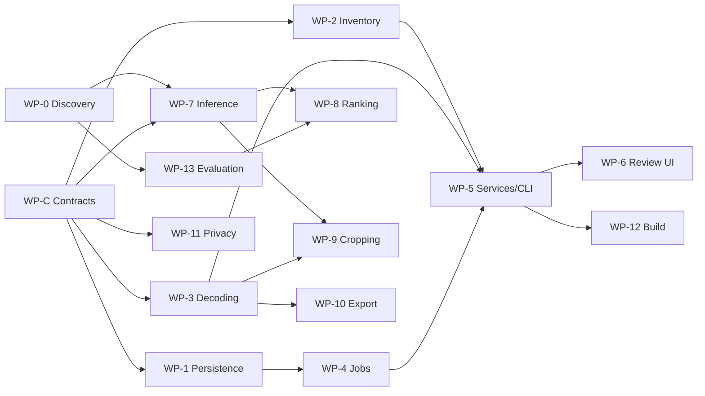

# Handoff: from POC to production

Audience: the engineering agents building the production app in `src/family_photo_curator/`.

**What is authoritative:** [Spec v1.1](../docs/spec/technical-specification-v1.1.md) for *what*, [High-level design](../docs/design/README.md) and [ADRs](../docs/adr/README.md) for *how*, and this POC for *evidence that it works*. Ground rules for every agent are in [AGENTS.md](../AGENTS.md).

---

## 1. How to use the POC

- **Port ideas and tests, not files.** The POC ignores the layering, has a flat schema, and uses placeholder models. Re-implement each piece in its production package behind the ports.
- **Keep its tests as a floor.** Each production work package should carry over the matching POC tests, rewritten against production interfaces, and add more. The synthetic event generator (`poc/tools/make_sample_event.py`) moves to `tests/fixtures/` as a shared fixture builder.
- **Delete `poc/` at the end of M4**, once every row of the map below is covered in production.

## 2. Port map

| POC piece | Production home | Keep | Change |
|---|---|---|---|
| `inventory.py` attribute classification | `adapters/cloud_files`, `core/inventory` | Flags, "unknown means unavailable", re-check before read | Sync roots from the registry; Cloud Files API fallback if attributes prove unreliable in M0 |
| `decode.load_oriented` | `core/decoding` (contract) + `adapters/decoder_pool` | Per-format orientation rule, versioned rule id, decode once, workers write derivatives to the cache | Per-task timeout with worker kill; memory budget; pixel caps; `nclx` → ICC; 16-bit path |
| `decode.run_isolated` | `adapters/decoder_pool` | Spawn context; re-run unfinished items alone after a crash to find the culprit | Long-lived pool, per-task timeouts, crash ledger (`decode_crash`) skipped until the decoder version changes |
| `features.py` | `core/features` + `adapters/inference` | Feature list, normalized boxes, primary-face idea, single-thread OpenCV in workers | **Replace Haar** with a DNN face detector with landmarks, a pet detector, and a real embedding model (M0 choice, ADR-0007 manifests) |
| `grouping.py` | `core/grouping` | Exact first; complete linkage in time windows; pHash catches copies with wrong timestamps; bursts need the same device | `BurstUUID` precedence; device clock offsets; calibrated thresholds; embedding similarity from the real model |
| `ranking.py` | `core/ranking` | Score with reasons; greedy recommendation with per-group cap, day coverage and redundancy; decisions as inputs | Versioned weights in config; stated objective (spec §10.2); preference fitting on labelled data |
| `crop.py` | `core/cropping` | Exact geometry, `validate()` invariant, 1-D search, weighted clipping (faces > pets), risk classes | High-res or tiled detection for approved photos; user protected regions; ratio check per spec §12.3 |
| `export.py` | `core/export` + `adapters/imaging` | Never overwrite, temp file then atomic rename, embedded sRGB ICC, no EXIF, re-decode verification, refuse source folders | P3/`nclx` conversion; rendering intent decision; lab profile; resolution warning surfaced in UI |
| `db.py` | `persistence` | Append-only decisions, projection, undo as an appended event | Full spec §14 schema, migrations, single writer thread, `ProcessingItem`, `ExportItem`, content identity |
| `pipeline.py` | `services` + `workers` | Main process is the only DB writer; per-item commit; on-result callbacks | Job manager with cancel/resume, progress events, configuration hash |
| `guard.py` | `security/network_guard` | Block in the main process and in every worker initializer | Logging of blocked attempts; firewall-rule option |
| `ui.py` | `ui/*` | Keyboard map, overlays (faces green/orange, pets blue, crop dashed by risk), group view, crop drag that respects the invariant | View-models, background loading, no DB access from UI (go through services) |

## 3. Contracts to agree first

Parallel work collides unless these shared types exist first. **WP-C** below delivers them as code plus docstrings in `core/` and `core/ports/`, reviewed before other work packages start their implementation.

| Contract | Defined by | Used by |
|---|---|---|
| `PhotoId`, content fingerprint, `PhotoRecord` | Spec §14.2 | Everyone |
| `OrientedImage` + `load_oriented` port | ADR-0006 | Decoding, features, cropping, export |
| `CacheKey` (content, analysis, algorithm, model, execution provider, orientation rule, config hash) | Design 02 §4.1 | Features, workers, persistence |
| `FeatureSet` (normalized boxes, scores, embedding reference) | Spec §7.2 | Features, grouping, ranking, cropping |
| `DecisionEvent` + projection | ADR-0008 | Services, UI, ranking |
| `CropDecision` + `validate()` | Spec §12.2–12.3 | Cropping, UI, export |
| `ItemResult` (status, error code, metrics) | Design 04 §5 | Workers, all stages |
| Port interfaces: `CloudFiles`, `Decoder`, `MetadataReader`, `Inference`, repositories | Design 01 §4 | Adapters, persistence, services |

## 4. Work packages

Each work package is sized for one agent (or one agent at a time), on its own branch, merged through PRs.

| WP | Milestone | Scope | Depends on | Done when |
|---|---|---|---|---|
| **WP-0 Discovery** | M0 | Run the POC on the real PC and folder; hydration test on real OneDrive; collect HEIC samples (orientation, `nclx`, MakerNotes); benchmark candidate models; license review and manifests; labelled evaluation subset; lock file | — | M0 exit criteria in spec §20; findings recorded as ADR updates |
| **WP-C Contracts** | M1 | Types and ports in section 3; architecture tests updated | — | Reviewed; other WPs build against it |
| **WP-1 Persistence** | M1 | Schema (spec §14), migrations, writer thread, repositories, decision log and projection, backup | WP-C | Crash-safety and projection tests; restart loses nothing |
| **WP-2 Inventory** | M1 | `adapters/cloud_files`, registry sync roots, two-pass inventory, path guard | WP-C | Mocked-attribute tests in CI; `onedrive`-marked test on the real machine |
| **WP-3 Decoding and metadata** | M1 | Decoder pool (timeouts, kill, crash ledger), decoding contract, ExifTool adapter, time, devices, clock offsets, Live Photos | WP-C | Orientation fixtures 1–8 + HEIC; crash and hang tests; metadata tests |
| **WP-4 Jobs** | M1 | Job manager, `ProcessingItem` ledger, cancel and resume, progress events | WP-1 | Kill-and-resume test equivalent to the POC's |
| **WP-5 Services and CLI** | M1 | Use-case facade, composition root, headless CLI | WP-1–4 | End-to-end headless run on the synthetic event |
| **WP-6 Review UI (M1)** | M1 | Grid, keyboard decisions, undo, import problems view | WP-5 | Faster than Windows Photos on a 300–500 photo batch (user test) |
| **WP-7 Inference and features** | M2 | Model registry and manifests, ONNX adapter, face + landmarks + eyes, pet detector, embeddings, quality | WP-0, WP-C | Benchmarks recorded; feature tests on fixtures |
| **WP-8 Grouping, ranking, recommendation** | M2 | Port POC logic; calibrate on labels; comparison UI; selective advanced analysis | WP-7 | Spec §19 grouping and ranking metrics on the test split |
| **WP-9 Cropping** | M3 | High-res detection, protected-region editor, crop search, risk classes, crop UI | WP-3, WP-7 | Several hundred labelled crops with a confidence interval |
| **WP-10 Export** | M4 | Colour (`nclx`/P3 to sRGB), verification, manifests, lab profile | WP-3 | 100% verification; colour check against reference files |
| **WP-11 Privacy and security** | M1→M4 | Network guard, firewall option, log sanitization, privacy and integrity test suites | WP-C | Blocked-network end-to-end test green |
| **WP-12 Build and release** | M1→M4 | Lock file, PyInstaller one-dir, signing, packaging smoke test in CI | WP-5 | Installer runs on a clean Windows VM |
| **WP-13 Evaluation harness** | M0→M4 | Labelling tool, train/test split, metric reports for spec §19 | WP-0 | Reproducible metrics report per milestone |

Parallel lanes after WP-C: **storage** (WP-1 → WP-4), **ingestion** (WP-2, WP-3), **privacy** (WP-11), and, once WP-0 lands, **ML** (WP-7 → WP-8) and **evaluation** (WP-13).

## 5. Open items the POC leaves for M0

Listed in the [POC README](README.md#what-the-poc-exposed-input-to-m0). The two that block M2 and M3 are **detector choice** (Haar is not acceptable) and **real iPhone HEIC behaviour** (orientation, `nclx`, MakerNotes) on the user's own files.
